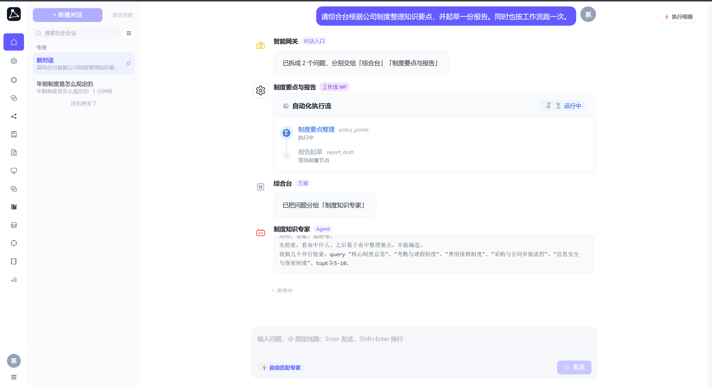
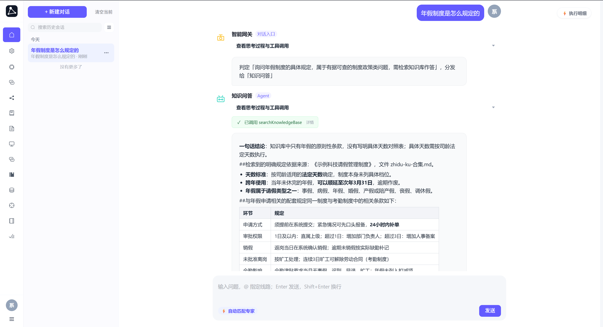
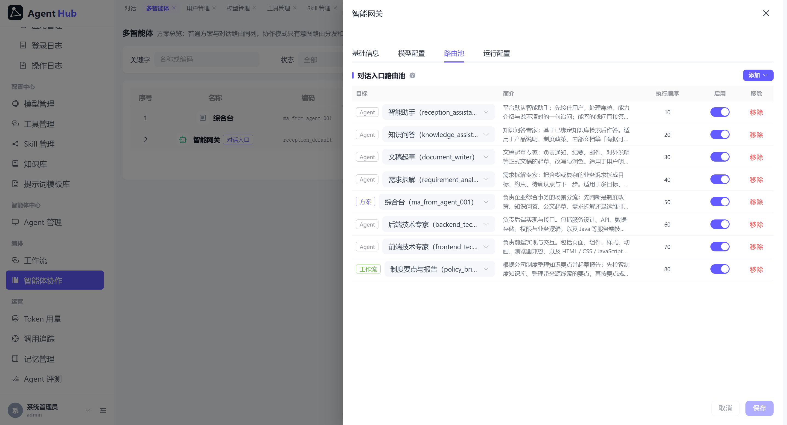
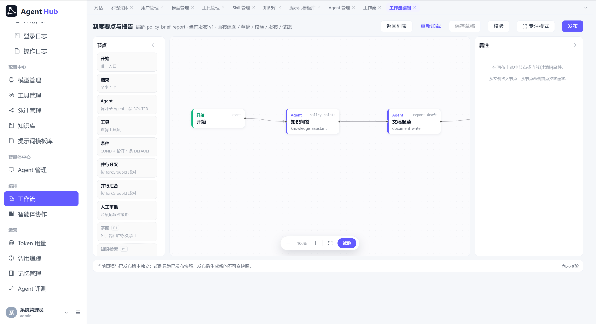
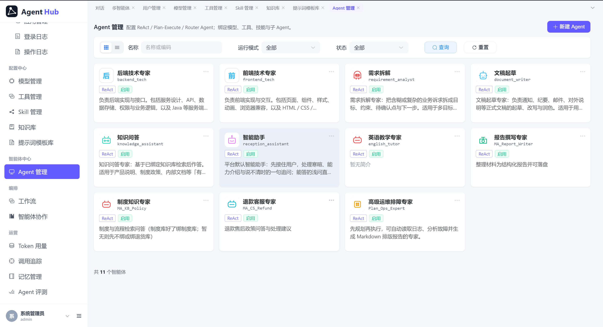
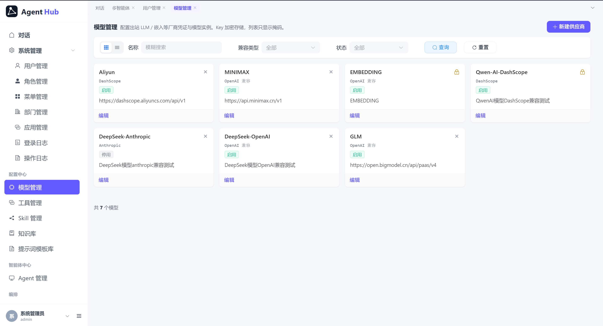
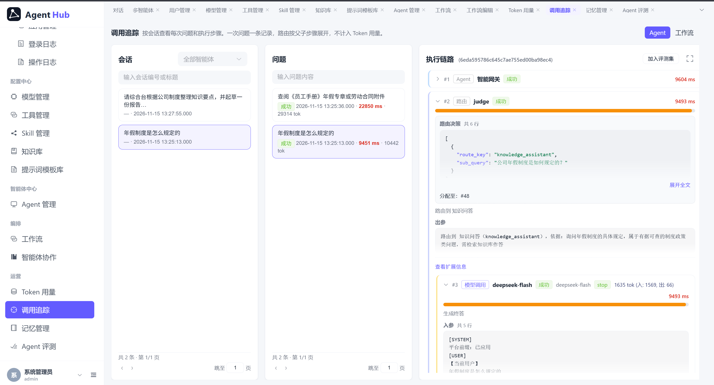

# AgentHub

**可独立部署的企业 Agent 中台。** 用配置把模型、工具、知识库、提示词、记忆、技能装成可运行的 Agent，再用统一的「对话」入口和运行、观测把它们用起来。

后端为单模块 Spring Boot，前端为 Vue 3 管理台；可以打成单个 jar 运行，也可以用 Docker Compose 拉起一套带依赖的环境。

[](LICENSE)




## 技术栈

| 层 | 选型 |
|---|---|
| 后端 | JDK 17、Spring Boot 3.2（单模块 Maven）、MyBatis-Plus、Sa-Token |
| Agent 引擎 | AgentScope-Java 2.0.4：ReAct、Plan-Execute 与分发执行 |
| 数据 | MySQL 5.7+（兼容 8.0）、Redis、Milvus 2.5+ |
| 前端 | Vue 3 + Vite + TypeScript + Element Plus + Pinia + Vue Router（工作流画布用 Vue Flow） |
| 交付 | Docker Compose（依赖 + 后端 + Nginx 前端）、单 jar 运行 |

## 界面


对话：一次提问只走一路。


多智能体：入口只做判定与分发，路由池可放单兵、方案与已发布工作流。


工作流：可视化画布，草稿与不可变发布版本分开。


Agent 管理：只放单兵，ReAct 与 Plan-Execute 两种执行方式。


模型管理：供应商 → 凭证 → 实例，按用途建实例并绑定。


链路追踪：一次提问一条追踪，判定、分发、子专家、工具与模型调用各占一个 span。

## 快速开始

### 1. 克隆与准备环境变量

```bash
git clone https://github.com/Desktop-code/AgentHub.git
cd AgentHub
cp .env.example .env
```

`.env` 不进仓库，按注释填库口令与主密钥。需要 JDK 17、Maven 3.8+、Node.js 20+。

### 2. 起依赖

```bash
docker compose up -d mysql redis
```

需要知识库时再加向量库链路（etcd 与 MinIO 是 Milvus 的依赖）：

```bash
docker compose up -d etcd minio milvus
```

### 3. 导入数据库

新库按顺序导入三份脚本：

```bash
mysql -uroot -p -e "CREATE DATABASE IF NOT EXISTS agenthub DEFAULT CHARACTER SET utf8mb4 COLLATE utf8mb4_general_ci;"
mysql -uroot -p agenthub < sql/agenthub.sql
mysql -uroot -p agenthub < sql/data-init.sql
mysql -uroot -p agenthub < sql/data-init-agent.sql
```

1. `sql/agenthub.sql`：建表，含全部结构增量。**只用于新库**，含 `DROP TABLE IF EXISTS`，勿在有数据的库上重跑。
2. `sql/data-init.sql`：部门、用户、角色、菜单、内置工具、平台约束与模板头。
3. `sql/data-init-agent.sql`：提示词段落、平台默认智能助手、入口 Router 默认方案与候选、工作台权限码。

### 4. 本机配置

```bash
cp AgentHub-server/src/main/resources/application-local.yml.example \
   AgentHub-server/config/application-local.yml
```

至少填主密钥与库账号口令，用知识库时再补向量库地址。`AgentHub-server/config/` 不进仓库；也可以改用环境变量注入。

### 5. 启动

```bash
cd AgentHub-server && mvn -DskipTests package
java -jar target/agenthub-server.jar
```

```bash
cd AgentHub-web && npm install && npm run dev
```

控制台 `http://localhost:5173`，后端默认 `8080`。

默认账号 `admin`，初始口令由配置项 `AGENTHUB_RESET_PASSWORD`（或 `agenthub.security.reset-password`）提供，仅开发用，生产必须改。

## 文档

- [架构设计](docs/architecture/AgentHub-架构设计.md)：分层、信息架构、运行时主链路、各能力域边界、部署拓扑。
- [功能说明](docs/architecture/AgentHub-功能说明.md)：各模块行为说明、仓库结构、运行与配置细节。
- [评测软评分服务](scripts/openjudge-sidecar/README.md)：契约、启动与排障。

## 开源协议与致谢

本项目以 **MIT** 许可发布，Copyright (c) 2026 Desktop-code / AgentHub，完整条款见 [LICENSE](LICENSE)。

第三方依赖的许可证与版权声明见 [THIRD-PARTY-NOTICES.md](THIRD-PARTY-NOTICES.md)、[AgentHub-web/THIRD-PARTY-NOTICES.md](AgentHub-web/THIRD-PARTY-NOTICES.md) 与 `LICENSES/` 目录。

工作流画布依赖 Vue Flow（MIT，Copyright (c) 2019-2025 webkid GmbH、Copyright (c) 2021-2025 Burak Cakmakoglu）。本项目只通过公开 API 引用其发行版，未复制或修改其内部源码；再分发时必须保留 `LICENSES/` 下的许可证正文。
