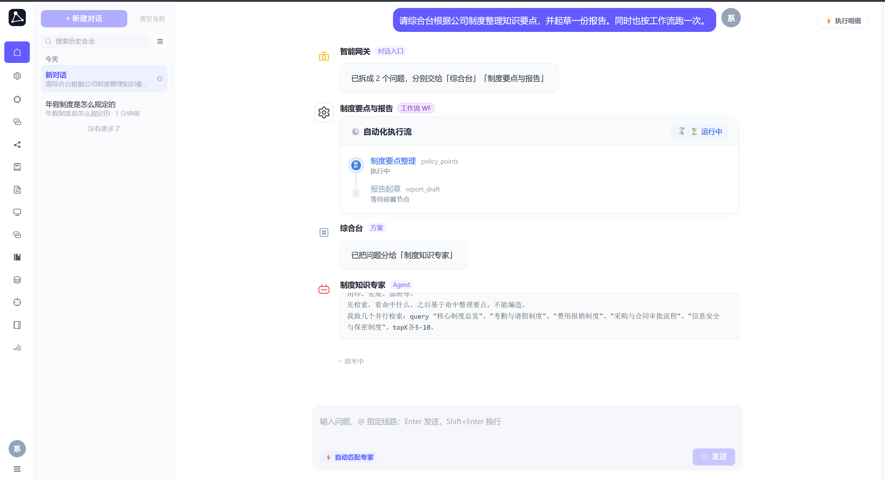
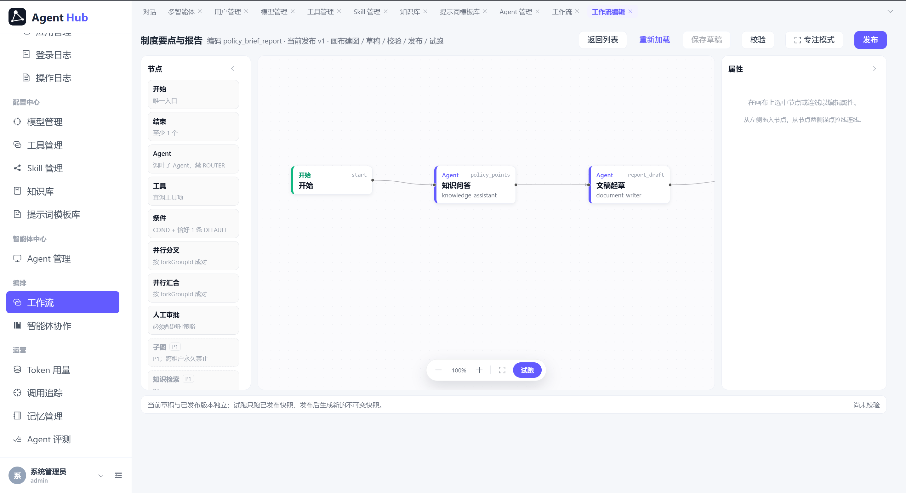
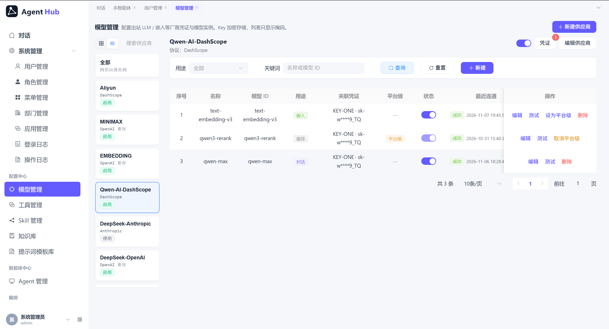
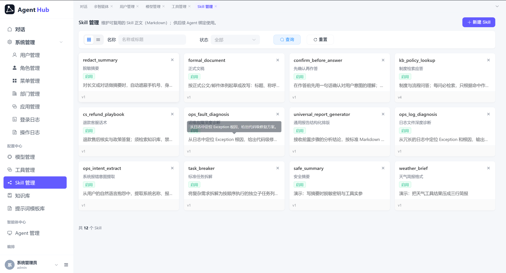
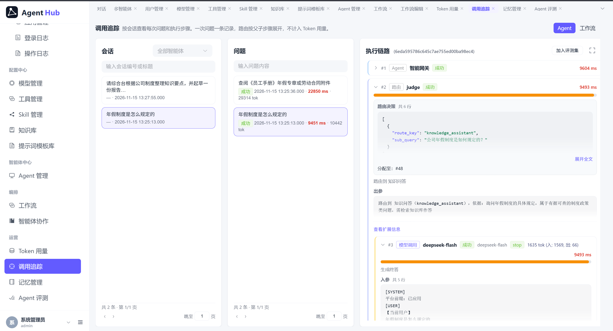

# AgentHub 功能说明

本文承接根 `README.md` 抽离出来的能力说明、仓库结构与运行配置细节，供需要了解具体行为、端口与本机配置的读者查阅。快速上手请看根 [README](../../README.md)，分域架构请看 [AgentHub-架构设计.md](AgentHub-架构设计.md)。

## 能力亮点

以下均为已落地、并在控制台可用的能力。

**一个对话入口，只做判定与分发**

面向使用者的正式入口只有一个，就是左侧最上面的「对话」，路径 `/workspace`。它自己不写业务话术，只回答一个问题：这一轮该交给谁。分发目标来自路由池——单兵专家、普通方案、已发布工作流都可以在池里。

入口在数据上是一条类型固定的方案记录，展示名固定为 `Router`，在列表里用「唯一入口」角标标识。它的名称、编码、类型、备注由平台锁定；判路由模型、路由提示词、路由池可以配。

**单兵与方案分开**

Agent 管理只放单兵：ReAct（边推理边调工具）与 Plan-Execute（先规划再逐步执行）。方案全部收在「编排 → 多智能体」，普通方案与入口 Router 同列在一张表里，用同一套四页签详情维护：基础信息 / 模型配置 / 路由池 / 运行配置。

方案不再依赖某个 Agent 当「根」：模型、提示词、说明、形象都配在方案自己身上，历史遗留的根字段只保留列，不再参与运行。

**方案只做分发，工作流承担复杂编排**

方案只保留两种协作模式，单选，默认第一种：

| 模式 | 怎么跑 | 上下文 |
|------|--------|--------|
| 意图路由分发 | 按候选简介选出一个或多个，并行执行 | 上下文隔离，各自只带自己的任务说明，互不传结论 |
| 路由后串行 | 先选出多个，再按执行顺序接力 | 必须继承前置结果，后一位会拿到前面已完成专家的成文结论 |

三步以上、带条件判断的复杂依赖交给工作流：可视化画布、草稿与不可变发布版本、运行、人工待办。方案的嵌套深度上限为 3，自挂与互挂会在保存时被拦下。

**模型中心**

供应商 → 凭证 → 实例三段式管理。按用途建实例与绑定：对话、路由、改写、摘要、记忆、嵌入、重排、视觉、语音识别、语音合成、护栏。出站走统一协议适配层，把不同厂家的请求、响应与流式事件收成同一套内部模型。

嵌入与重排支持平台级实例，供记忆的语义召回与检索后重排使用，不按 Agent 绑定解析。连通测试按「协议 × 用途」分流，协议确实没有该用途端点时明确报不支持，不拿对话接口冒充。

**工具与 MCP**

两层目录「工具源 → 工具项」，内置工具与 MCP 源同页管理。MCP 支持 SSE 与 Streamable HTTP 两种传输，按远端列表同步工具项，新同步项默认停用、人工启用。

进 schema 只有一条判据：工具源启用、工具项启用、Agent 已绑定。装配与执行共用这条判据。工具必填参数在本轮输入、会话上下文、已注入长期记忆三档都无依据时，不执行工具，改为向用户追问。

**知识库**

建库即建集合，向量维度跟嵌入模型锁定。文档入库是一条流水线：格式白名单 → 解析 → 结构识别 → 按文档类型路由切片策略 → 向量化 → 双写向量库与切片表，状态与进度落库，可重试、可换片长重切。

检索是双路召回加融合：向量召回与可选关键词召回融合后截断，回表补全正文，再可选重排。以工具形式交给 Agent，库范围只来自 Agent 绑定，模型无法越权指定库。未绑定、无命中、向量库不可用三种情况各有固定话术，不用空结果冒充「没查到」。

**提示词三层**

平台全局约束 → 按用途的模板 → 单兵或方案的覆写。锁定段不可改，开放段与追加区可改；组装只有一条链路，按预算尾部截断，锁定段永不裁剪。缺约束、缺模板、缺必选段一律阻断出站，不拼半截提示词。

**记忆**

短期记忆、长期记忆、工作记忆三层。长期记忆只在三处抽取：显式「记住」、会话收口（空闲 / 取消 / 删除）、滚动摘要成功之后；每轮成功或失败都不抽。入库前做事实键归并，同义偏好收敛到规范键，用户纠错会覆盖旧值。

长期记忆以库为真源，向量集合是可重建副本。没有平台级嵌入、集合未就绪或出站失败时，召回直接回落库内排序，不空手也不编造；换维只能走受控重建，代码不会静默删生产集合。

**观测与计量**

一次提问一条追踪，一步一个 span，父子成树，能看出判定、分发、子专家、工具与模型调用。Token 用量按每次模型调用记流水，另做业务日汇总。追踪写失败不影响对话与计量；追踪上的 token 字段只用于展示，计费真源是流水。

**评测**

用例集 → 复用现网运行入口跑批 → 规则断言做硬门禁 → 可选软评分。软评分默认不翻转门禁结论；评分服务未启动时标记为跳过。

**语音**

输入框旁可整段听写，回答可自动朗读或单条重听。只认该 Agent 的语音模型槽，不拿对话模型冒充识别或合成；合成失败或未绑定可回落浏览器朗读。

**基座**

Sa-Token 单栈鉴权、菜单与按钮级权限码、部门路径前缀数据范围、登录与操作日志、调用方应用密钥只存哈希。发消息支持幂等键，同会话同键同内容只真正跑一轮；进程重启后残留的「运行中」会被收成已取消。

---

## 仓库结构

| 目录 | 职责 |
|------|------|
| `AgentHub-server/` | 后端单模块。按业务域分包，域内再分接口、应用、领域、基础设施四层 |
| `AgentHub-web/` | 管理台。页面、组件、接口封装、状态与路由分开 |
| `sql/` | 全量建表、菜单与内置资源种子、当期结构增量 |
| `scripts/` | 辅助进程与本地工具，例如评测软评分服务 |
| `docs/` | 架构设计与各域说明 |
| `LICENSES/` | 第三方许可证正文 |

后端域包按业务划分，不按技术分层平铺：基座、模型、工具、技能、提示词、Agent 与方案、运行时、知识库、记忆、工作流、评测、计量、追踪各自一包。

---

## 运行与部署

### 1. 环境

- JDK 17（Maven 前把 `JAVA_HOME` 指向 17）
- Maven 3.8+
- Node.js 20+ 与 npm
- MySQL 5.7+、Redis；需要知识库时再加 Milvus 2.5+
- Docker 与 Docker Compose（可选，但用 Compose 起依赖最省事）

### 2. 起依赖

- 复制环境变量模板 `.env.example` 为 `.env`，按注释填库口令与主密钥；`.env` 不进仓库。
- 起基础依赖：`docker compose up -d mysql redis`。
- 需要知识库时再加向量库链路：`docker compose up -d etcd minio milvus`。
- Milvus 首次启动要建元数据并预热，健康检查带预热期；后端不依赖它启动，未就绪时只有建库、重建、检索会报「知识库不可用」。

### 3. 导入数据库

新库按顺序导入三份正式脚本：

| 顺序 | 文件 | 内容 |
|------|------|------|
| 1 | `sql/agenthub.sql` | 唯一一份建表脚本，含全部结构增量；仅用于新库或整库重建 |
| 2 | `sql/data-init.sql` | sys 与平台基础：部门、用户、角色、菜单、内置工具、L1 平台约束、5 条模板头 |
| 3 | `sql/data-init-agent.sql` | 运行必需的非 sys 配置：提示词 L2 段落、平台默认智能助手、入口 Router 默认方案与候选、工作台权限码 |

- 全量脚本 `sql/agenthub.sql` 含 `DROP TABLE IF EXISTS`：只用于新库，已有数据的库重复执行会清空数据。
- 三份脚本都只跑一次，均非幂等；已初始化的库不要重跑。
- 用 Compose 起全新数据卷时，MySQL 容器首次启动会自动执行第 1、2 份（见 `docker-compose.yml` 的 `docker-entrypoint-initdb.d` 挂载）；确认成功后再手动补第 3 份。已有数据卷不会自动执行任何脚本，需按上表顺序手工导入。
- 存量库升级：按当期增量脚本逐条补齐，不要重跑全量脚本，也不要删除既有表。
- `sql/data-init-test-tmp.sql` 仅用于测试与演示（示例专家、示例 Skill、示例工作流等），不是新库必跑，且不进仓库。

### 4. 配置本机参数

- 复制 `AgentHub-server/src/main/resources/application-local.yml.example` 为 `AgentHub-server/config/application-local.yml`，它会被自动加载；也可以改用环境变量注入。
- 至少给出：主密钥、库账号口令；使用知识库时再补向量库地址。主密钥可用系统自带的安全随机方式生成 32 字节（或 `openssl rand -hex 32`）。
- `AgentHub-server/config/` 与 `secrets/` 都不进仓库；用 Compose 起后端时，外部配置挂在 `secrets/` 下。
- 本地配置不要写进 `src/main/resources`：那份目录会整体打进 jar 与镜像，主密钥和库密码会随制品分发。

### 5. 启动

- 后端：在 `AgentHub-server` 目录打包并运行生成的 jar，产物名为 `target/agenthub-server.jar`。
- 前端：在 `AgentHub-web` 目录安装依赖后跑开发服务。
- 控制台默认 `http://localhost:5173`，后端默认 `http://localhost:8080`，接口文档挂在后端。
- 开发环境默认账号 `admin`，初始口令由配置项 `AGENTHUB_RESET_PASSWORD`（或 `agenthub.security.reset-password`）提供，仅开发用，生产必须改。

### 6. 第一次登录后按顺序配

模型供应商 → 凭证 → 模型实例（按用途）→ 工具源同步并启用需要的工具 → 知识库（可选）→ 单兵 Agent 与绑定 → 多智能体里配置入口 Router 的路由池 → 回到「对话」开始用。

### 常见端口

| 组件 | 宿主端口 | 说明 |
|---|---|---|
| 后端（直跑 jar） | `8080` | 前端接口默认指向这里 |
| 前端开发服务 | `5173` | 已在后端跨域白名单 |
| Compose 后端 | `8081` → 容器 `8080` | 与本机 jar 同时跑时避免冲突 |
| Compose 前端 | `8088` → `80`、`8443` → `443` | 容器内 80 只做跳转，实际访问 `8443` |
| Redis | `6380` → 容器 `6379` | 记忆窗口、短期记忆、提示词缓存 |
| Milvus | `19530`、`9091` | 前者 gRPC，后者健康检查与指标 |
| MySQL | 默认不暴露 | 需要时再开宿主映射 |

端口被占用时，后端换端口要同步改前端接口地址与后端跨域白名单，不要只改一侧。

---

## 配置与安全

- **密钥不进仓库**：模型与 MCP 的密钥加密存库、列表与详情只出掩码，创建或重置时明文只返回一次；调用方应用密钥只存哈希。主密钥来自环境变量，缺失时进程启动即失败。
- **不进版本库的内容**：环境变量文件、外部配置目录、证书与私钥、日志、运行产物目录、本机数据库文件。
- **示例值不是凭据**：模板与编排文件里的口令都是占位符，生产必须用真实环境变量覆盖；文档不贴任何完整密钥样例。
- **主密钥可轮换**：配置旧密钥后启动，旧密文会被自动重写为新密钥，迁移完成再移除旧密钥。
- **运行工作区**：会话级文件工具的落盘根目录可配，默认落在进程工作目录下的隔离目录；只放运行产物，不参与备份。
- **时间与鉴权**：时区统一为东八区，Token 走 `Authorization: Bearer`，权限码统一为「域:资源:动作」，菜单种子、后端注解与前端按钮同码。
- **测试代码不进公开仓**：前后端单元测试与自测守卫只在本地跑，干净克隆不含用例；改动主链路时请在本机保留对应的回归用例。

---

## 相关文档

- [架构设计](AgentHub-架构设计.md)：定位与非目标、逻辑分层、前端信息架构、身份与入口、运行时主链路、各能力域职责边界、数据与安全、部署拓扑、已落地与未做对照。
- [根 README](../../README.md)：项目定位、技术栈、界面截图与快速开始。
- [评测软评分服务说明](../../scripts/openjudge-sidecar/README.md)：契约、启动、排障。
