# AgentHub 架构设计

| 项 | 内容 |
|----|------|
| 版本 | v2.2 |
| 日期 | 2026-11-24（Asia/Shanghai） |
| 文档性质 | 稳定架构说明书：讲分层、职责、关系与主链路，供研发与架构对齐。不是开场备忘、不是变更记录、不是代码注释汇编 |
| 口径 | 与 2026-11-24 现网 main 一致；读到与本文冲突的旧定稿或旧页面描述时，以现网为准 |
| 图示 | 仅使用 Markdown 内嵌 mermaid 的 `flowchart` 与 `sequenceDiagram`；截图与实拍一律留占位 |

> 命名说明：控制台里用户可见的入口名是「对话」，路径仍是 `/workspace`；后端包名与接口路径沿用 `workbench`，入口类型码是 `ENTRY_ROUTER`，这些都属内部实现命名，不作为产品名对外使用。入口展示名读配置，默认 `Router`，可在入口详情里改。产品用语统一用「运行」，不用「试跑」。

---

## 1. 定位、目标与非目标

### 1.1 定位

AgentHub 是**可独立部署的企业 Agent 中台**：一套单模块 Spring Boot 后端加一套 Vue3 管理台，可以打成单个 jar 运行，也可以用 Docker Compose 组成一套自带依赖的完整环境。它同时保留了作为微服务接入客户网关与注册中心的扩展缝，但一期只做 standalone。

它要解决的问题不是「再造一个聊天框」，而是把**模型、工具、知识库、提示词、记忆、技能**这些能力收成可配置、可复用、可观测的资源，再让这些资源以「单兵」与「方案」两种形态被运行起来。

三条贯穿全系统的产品判断：

1. **配置驱动**：能在控制台配的，不写死在代码里；配完立刻能运行，不需要改配置发版。
2. **入口唯一**：面向使用者只有一个正式入口，入口只做判定与分发，不承接业务话术。
3. **可观测**：一次提问能回答「分给了谁、为什么、花了多少」，不是黑盒。

开源协议当前是 **MIT**。

### 1.2 三类身份

| 身份 | 载体 | 用途 |
|------|------|------|
| 平台用户 | 用户 / 角色 / 菜单 / 部门 | 登录控制台，配置资源、运行 Agent、看运营数据 |
| 调用方应用 | 应用 + 密钥 | 代表外部系统调用平台能力。密钥只存哈希，明文只在创建或重置时返回一次 |
| 终端用户上下文 | 租户 / 用户 / 范围透传 | 由接入方带入，平台只透传，不自建业务行级权限引擎 |

平台只做薄 RBAC：谁可以配模型、谁可以改 Agent、谁可以运行、谁可以看运营数据。业务侧的细粒度数据权限不由平台承担。

### 1.3 目标

- 控制台闭环「能配 → 能运行 → 能量 → 能看」。
- 单兵与方案职责清晰：单兵是一个专家，方案是分发，工作流是流程。
- 同一轮运行的事件、追踪、计量各落各表，职责不混：事件回答「说了什么」，追踪回答「怎么走的」，计量回答「花了多少」。
- 运行不总是问一句答一句：工作流与串行方案可以在对话里停等并续跑同一轮，用户回复或选项回到原节点 / 原卡继续，不另起一条运行。
- 密钥边界清晰：调用方密钥只哈希，模型与工具凭证可解密出站，日志与追踪不出密钥。

### 1.4 非目标（当前阶段不做）

| 不做 | 说明 |
|------|------|
| 若依式多模块单体 | 单模块 Maven，按域分包，不引第二套骨架与包名 |
| 双鉴权栈 | 只用 Sa-Token，不叠 Spring Security |
| 用 SAA 替换 AgentScope 作默认引擎 | 编排补充可以，默认 ReAct 与分发引擎不变 |
| 入站 apiKey 直接调 Agent | 待应用授权补全后再做 |
| 多层 / DAG 路由 | 方案嵌套有深度上限，不做任意图 |
| 平台级租户切换 | 一期租户由配置提供 |
| 容器级沙箱 | 现网仍是运行目录隔离，不是容器隔离 |
| 督导循环 / 运行中重规划 | 分发之后「评估要不要继续或重新规划」的闭环未做，运行中不改路线 |
| 工作流循环节点 | 画布尚无循环节点；循环次数、超限出路、迭代上下文与同节点多轮回放均未做 |
| 企业级方案闸门 | 「动态选人 + 静态闸门」尚未交代码；现网方案仍只做分发，深度上限 3 |
| 企业级审批闭环 | 对话内停等与人工待办已落地；审批策略、超时升级与留痕尚未按企业级补齐 |
| 按依赖自动改串行 | 由配置决定协作模式，不自动改判 |
| 非 token 计量 | 只做 token 计量，单价与计价展示当前关闭 |

---

## 2. 逻辑分层

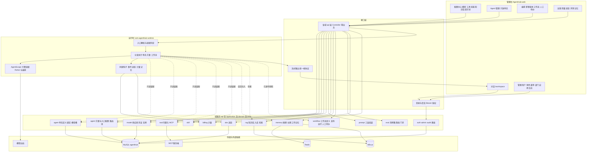

### 2.1 分层职责

| 层 | 职责 | 硬约束 |
|----|------|--------|
| 管理台 | 配置资源、运行、看运营数据 | 页面只管交互与展示，业务规则不写在前端做最终裁决 |
| 接口层 | 鉴权、参数校验、DTO 转换、流式写出 | Controller 零业务，不直连仓储 |
| 域服务 | 各业务域的规则、事务与持久化 | 不跨域直接读写对方的表与实体 |
| 运行时 | 装配只读快照、驱动引擎、写事件、调用钩子 | 不在运行时重写记忆、检索、计量、追踪的完整方案 |
| 存储 | MySQL 为真源；Redis 做热数据与窗口；Milvus 做向量副本 | 向量失败不回滚业务库 |

### 2.2 域包地图

后端按业务域分包，域内再分 `api` → `application` → `domain` → `infra` 四层：

| 包 | 职责 |
|----|------|
| `common` | 统一响应、错误码、分页、线程池与通用配置；不放业务 |
| `spi` | 身份映射、上下文持有、密钥存储、RAG 扩展等接口缝；只定契约 |
| `auth` `admin` `audit` | 登录、Token、权限加载；用户角色菜单部门应用；登录与操作日志 |
| `model` | 模型供应商、凭证、实例、连通测试、用途槽 |
| `tool` | 工具源与工具项，内置与 MCP 同一套目录 |
| `skill` | 可复用 Markdown 正文与绑定 |
| `prompt` | 平台约束、按用途模板、Agent 覆写与统一组装 |
| `agent` | 单兵定义与绑定、方案与入口配置、路由池规则 |
| `runtime` | 入口解析、分发执行、会话与事件、流式输出、计划确认 |
| `rag` | 知识库、文档入库与切片、检索与重排 |
| `memory` | 短期 / 长期 / 工作记忆，抽取、合并、召回、向量旁路 |
| `workflow` | 工作流定义、画布校验、发布快照、运行与人工待办 |
| `eval` | 用例集、跑批、规则门禁、软评分适配 |
| `billing` | 调用流水与业务日汇总 |
| `obs` | 一次提问一条 trace，一步一条 span |

跨域只走两类缝：一是**只读装配**（运行时按 id 读配置域快照），二是**钩子接口**（计量、追踪、记忆召回）。禁止把某一域的业务规则搬进另一域的实现里。

### 2.3 关键设计取舍

- **为什么不按「一个大 Context 扛全部」设计**：对话、账单、追踪的真源与生命周期不同。合成一个对象后，任何一侧失败都会污染另一侧；拆开后追踪失败不影响对话，计量撞键不打断回答。
- **为什么运行时不自己实现记忆/检索/计量**：这些能力有各自的幂等、降级与重建策略。放在运行时里会分裂成两套口径，改一处漏一处。
- **为什么入口方案不绑 Agent**：绑根会让「方案」依赖一个 Agent 的模型槽、提示词槽与形象，等于把方案的身份寄生在 Agent 上。断开后方案就是自己的根，形象、说明、判路由模型都配在方案自己身上。

---

## 3. 前端信息架构

### 3.1 壳与视觉

左侧栏通顶 + 右侧主区，无顶栏、无 workspace 切换；浅灰底、白卡、紫色主色。长页面用多页签缓存，切页保留输入与滚动位置。「对话」是唯一整屏页：进入后默认收起侧栏、隐藏页签条。

### 3.2 侧栏分组

| 分组 | 内容 |
|------|------|
| 对话 | 顶层独立入口，即 `/workspace` |
| 管理 | 用户、角色、菜单、部门、应用、登录日志、操作日志 |
| 配置中心 | 模型管理、工具管理、Skill 管理、知识库、提示词模板库 |
| 智能体中心 | Agent 管理（只放单兵） |
| 编排 | 多智能体、工作流、人工待办 |
| 运营 | Token 用量、调用追踪、记忆管理、Agent 评测 |

「对话」这一项在壳里是固定入口，不在菜单表里维护，因此角色授权只影响能否调用接口，不影响是否看到这一项。

### 3.3 关键页面

> 截图说明：本节图为 2026-11-15 实拍；现网新增的对话内停等、运行时限与引用区未重拍，行为以正文为准。

**对话**：左栏会话历史，右栏对话主区。主区的结构是产品结构，不是调试输出：

- 按参与者成块：本轮入口判定的那一块在最上面，写清分给了谁；一条消息里有多个问题时，入口块一次列清各问去向，各路按问题分别成块；被调用的方案有自己的块，块里写它分给了哪些专家；每位专家各自一块，带自己的可见结果。
- 工作流在消息流里是一张单独的执行卡，位置固定在入口块之后、方案与专家块之前。
- 工作流执行卡可在对话里停等用户回复或选项，选完记在原节点 / 原卡上并回到同一条运行续跑，不另插一条用户气泡；直播与回放读同一份投影，不另起时间线。
- 工作流可配整段与单节点运行上限，卡片展示上限与剩余；等待输入期间不计入时限。
- 块一旦出现，位置就固定；收尾与回放只往已有块补数据，不按落库顺序重排。
- 思考默认折叠，展开才看推理与工具步骤；全场轨迹作为补充信息默认收起。
- 文件产出挂在写出该文件的专家气泡里，不集中堆在末尾。
- 检索类回答落地后，出处贴在结果旁：默认一行摘要，展开按文档分组，再展开看该段原文；无出处不占位，进行中不提前摆出。
- 方案块不复制子专家正文；只有该方案真的产出了汇总结论时，才多一块方案结论；汇总失败降级为拼接时不打「方案结论」标记。

对话页按职责拆分：壳层与消息投影在 `ChatPanel` / `WorkbenchChat`，方案卡、工作流执行卡、工具条、选项、结果框与引用区拆到 `workbench/chat`。拆分只移动实现与样式归属，交互、文案以及直播 / 回放同一投影的关系不变。

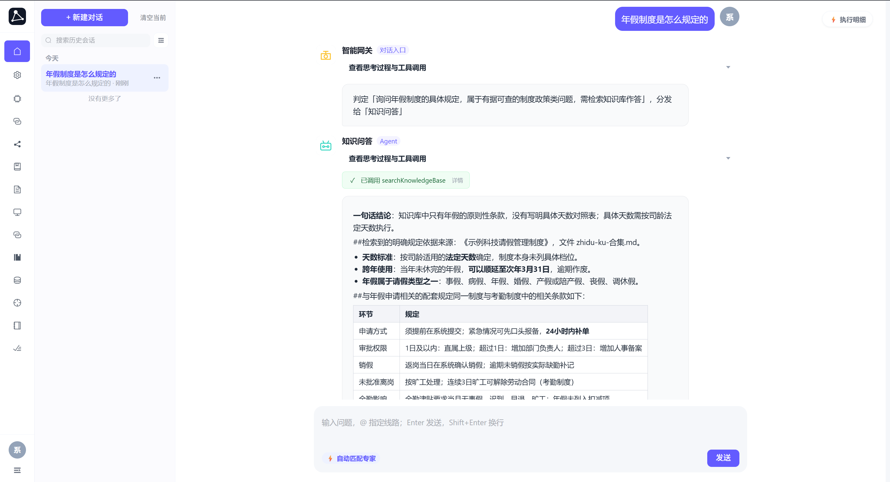

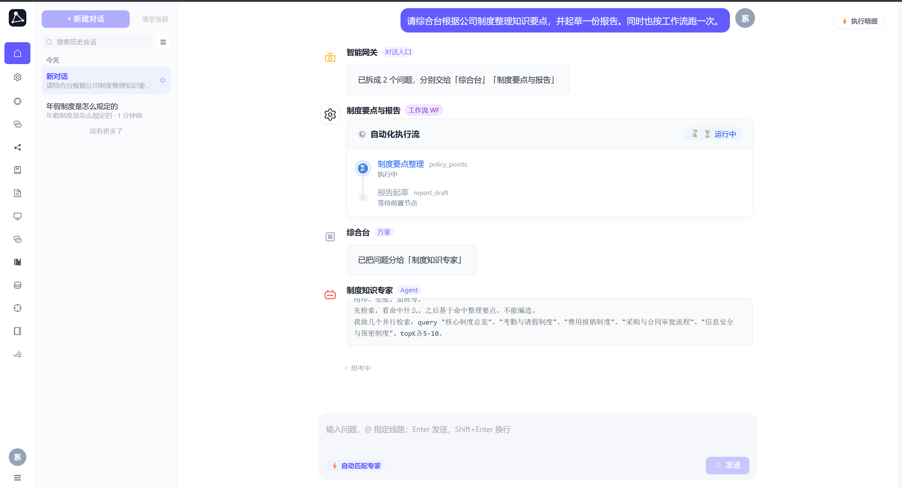

**Agent 管理**：只列单兵，运行模式只有 ReAct 与 Plan-Execute；卡片列表进详情，详情按基本信息 / 模型配置 / 工具 / 技能 / 记忆 / 知识库 / 运行配置分页签。列表上的「对话」是单兵自测入口，不是正式对话入口。

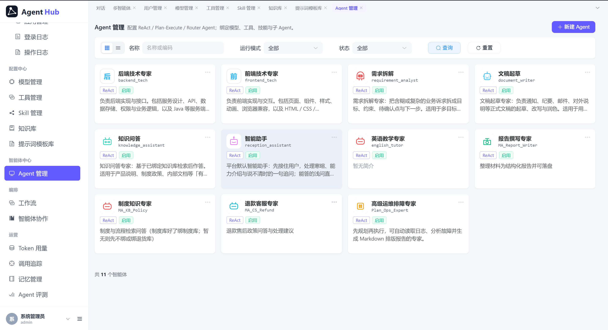

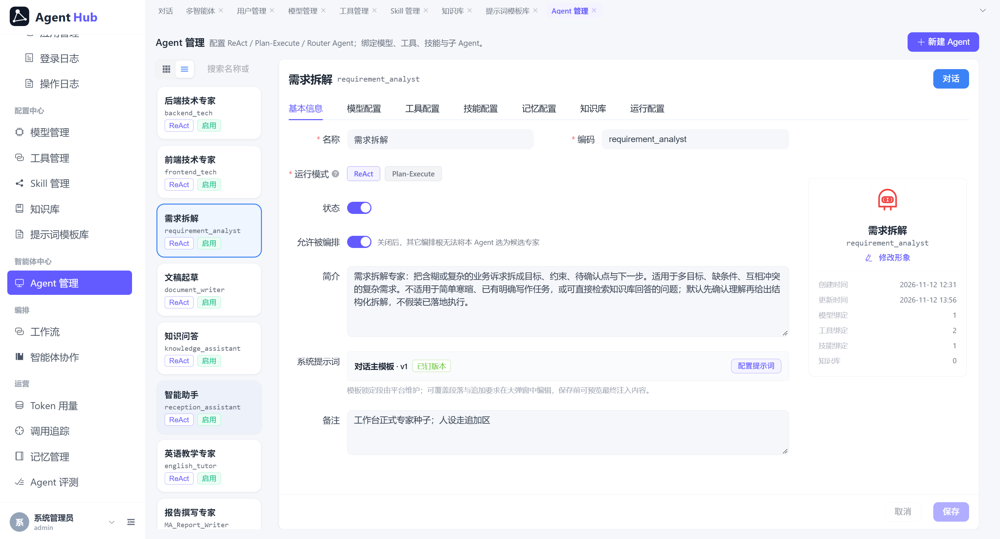

**多智能体**：普通方案与入口 Router 同列在同一张列表，入口那一行带「唯一入口」角标、不可删除、状态不可关。新建只能建普通方案；入口不能新建第二个。方案详情统一四个页签：基础信息 / 模型配置 / 路由池 / 运行配置。路由后串行（以及固定串行）可在成员询问处中途停等，续跑同一位成员后接着跑剩余成员；并行分发不中途停等。旧版本里的方案流程画布已去掉，画布只保留在工作流。

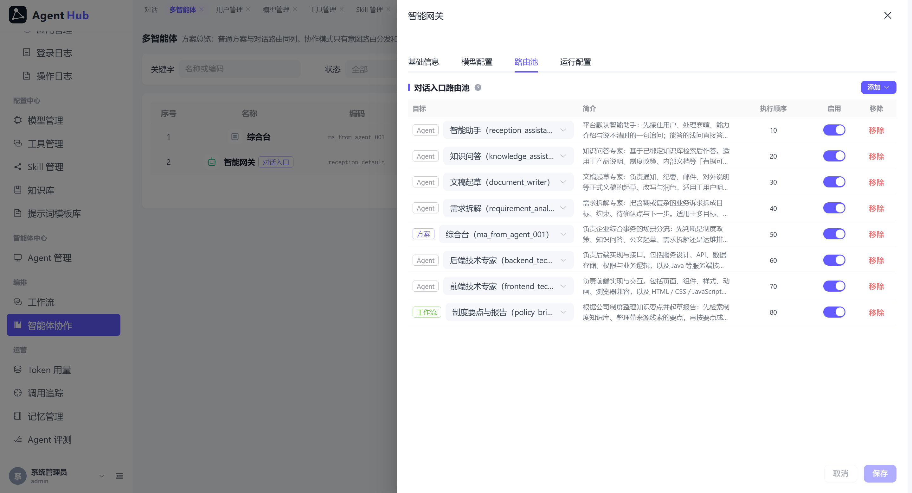

**工作流**：独立一级页面，画布负责复杂依赖与条件分支；编辑与运行分开，运行只认已发布快照。AGENT 节点可配「等待回复」，在对话执行卡里停住，用户点选项或直接输入后回到同一条运行续跑；整段与单节点运行上限按分钟配置，卡片展示上限与剩余，等待时间不计入。人工待办仍是 HUMAN 节点的独立薄页，只做「看 + 通过 / 驳回」，未废弃。

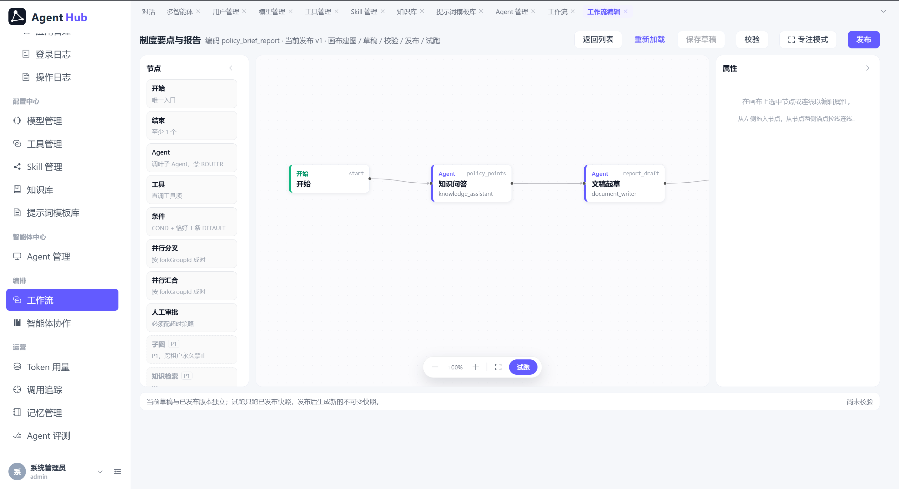

**配置中心与运营**：模型、工具、技能、知识库、提示词各自一页；运营侧是用量、追踪、评测三页，追踪按可见范围裁剪，普通用户只看自己的。

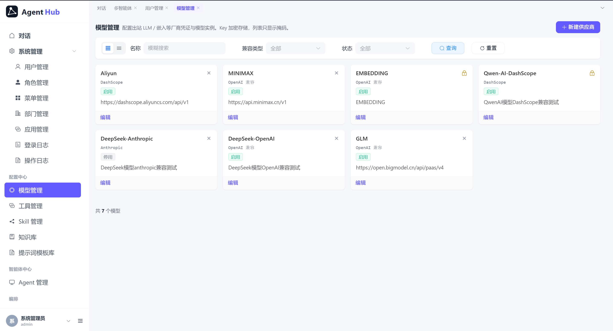

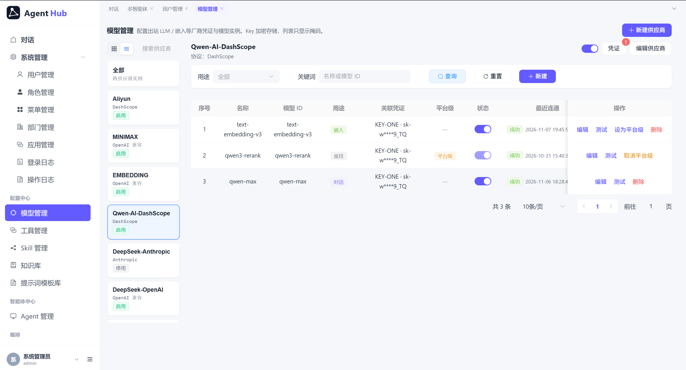

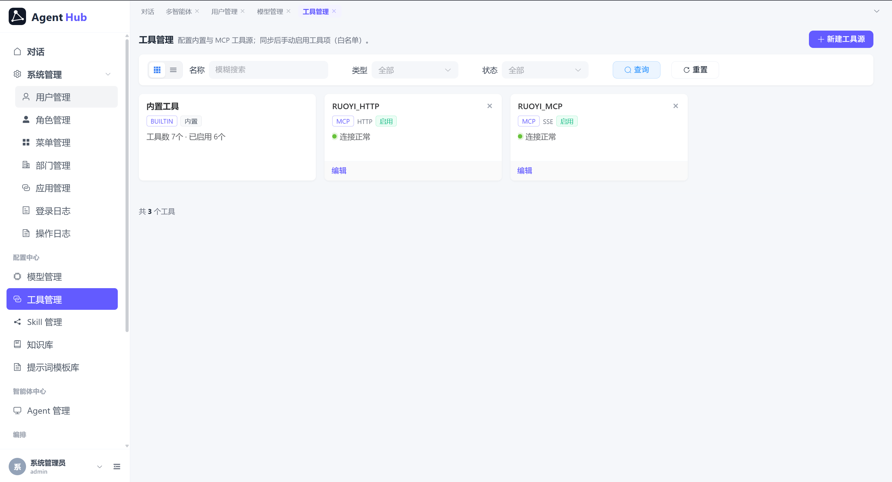

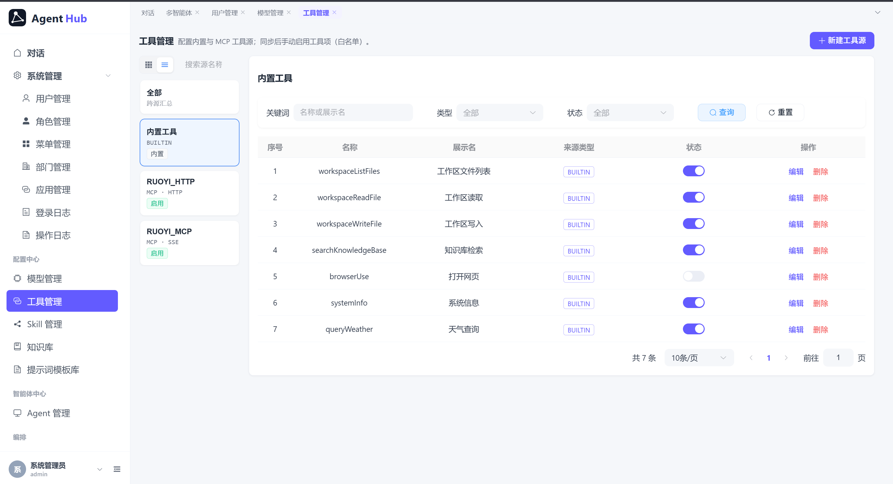

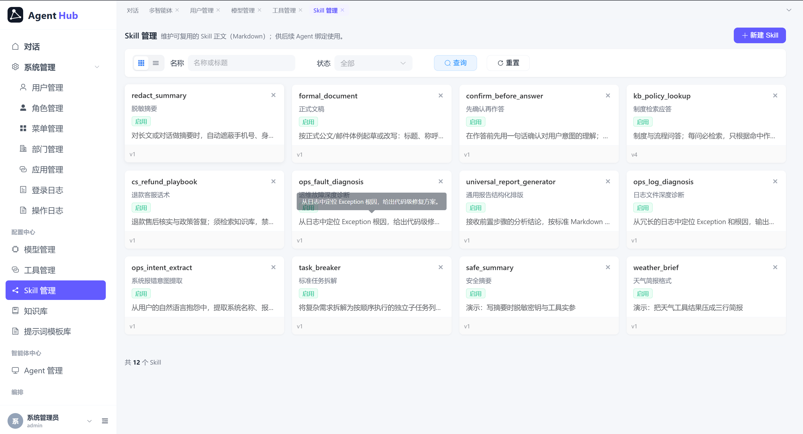

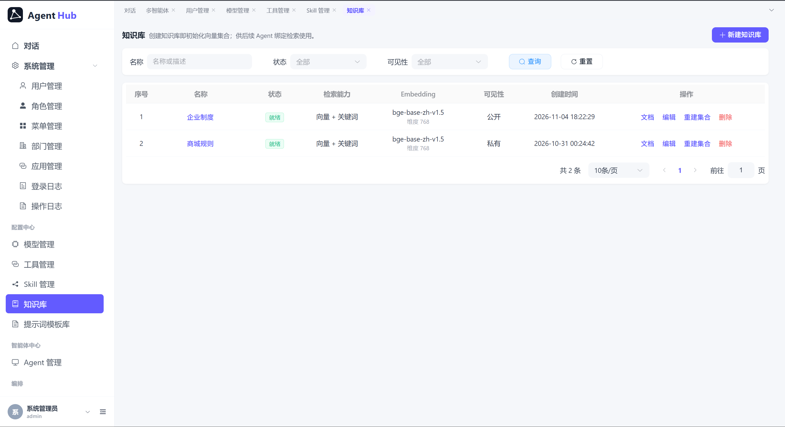

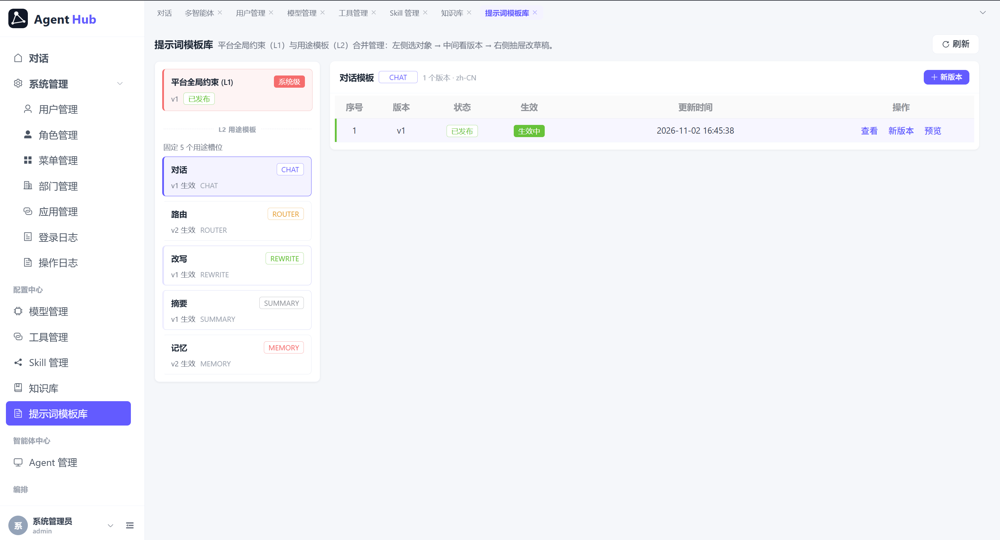

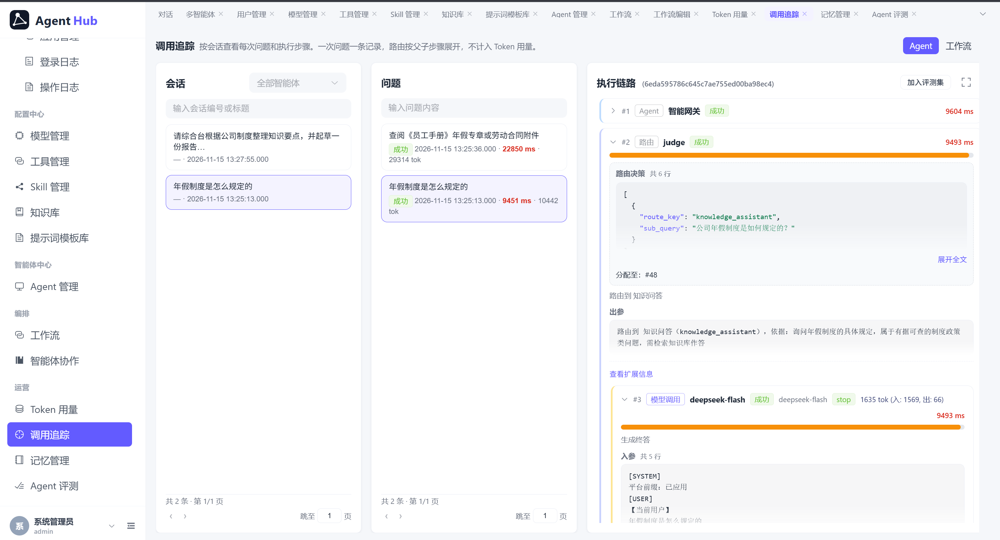

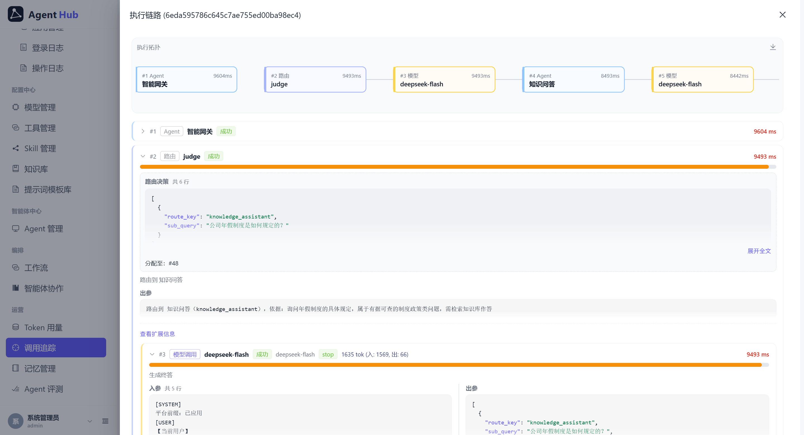

---

## 4. 身份与入口

### 4.1 入口的形态

面向使用者的正式入口只有一个：**对话**。它背后是一条类型为入口 Router 的方案记录，默认展示名为 `Router`，名称可改；在列表里用「唯一入口」角标标识——角标是标记，不是按钮。

这条记录的特殊性只体现在三处：

1. **身份锁定**：编码、类型、备注由平台固定，页面只读，后端再拦一道，改任何一个都直接拒绝；名称不属身份字段，可改，改名后列表、详情与消息流入口块同源生效。
2. **唯一性**：由数据库结构保证每租户最多一条入口，不靠应用层自觉。
3. **不可入池**：入口不能被加进任何路由池，也不能作为别人的子专家。

除了这三处，它和普通方案完全一样：判路由模型可配、ROUTER 提示词可配、路由池可增删、运行参数可调（页面当前把与总分流无关的项置灰，属交互收口，不是协议限制）。

### 4.2 单兵、方案、入口的关系

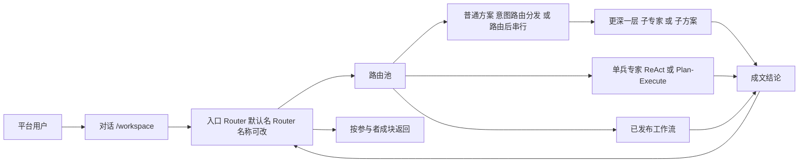

- **单兵**：一个专家，自己推理、自己调工具、自己作答。只出现在 Agent 管理里，不会再出现在方案的编排里被当成「根」。
- **方案**：只做分发。它决定「这一轮该谁来做」，不承担具体业务产出。
- **入口**：方案的一种，但数据锁定且唯一；它的路由池就是全平台的分发面。
- **工作流**：有明确步骤、分支、条件与人工卡点的流程，被方案当成一个可选目标。

### 4.3 为什么不再绑虚拟根

旧实现里方案要绑一个 Router 类型的 Agent 才有「根」，没有根就现造一个壳。这带来三个问题：方案的模型槽与提示词寄生在 Agent 上；Agent 管理与方案列表互相污染；删除或改动那个 Agent 会连带影响运行。

现在方案**就是自己的根**：判路由模型、ROUTER 提示词、方案说明、形象都挂在方案自己身上。底层表里历史列仍然存在，但已**不再作为协议使用**——不读它、不写它、不据它决定能不能运行。历史数据里残留的值不会让运行失败，也不会让方案消失。

对应地，Agent 管理只列单兵：既排除 Router 类型，也排除历史上被方案当成根的那些 Agent。这条过滤目前仍通过历史列做子查询实现，属于收尾中的技术债，不影响产品口径。

### 4.4 入口唯一性如何保证

- 结构层：入口有一个由类型推导出来的槽位列，配合租户维度的唯一索引，第二行入口无法写入。
- 应用层：保存入口时校验编码、类型与备注未被修改（名称可改）；入口不能停用、不能删除、不能入池。
- 运行层：会话创建一律按服务端认定的入口开，忽略前端可能传来的 Agent 或方案 id。

---

## 5. 运行时主链路

### 5.1 一次对话怎么走

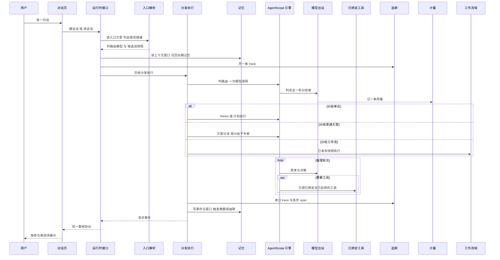

要点：

- **一次提问一条 trace，一步一条 span**；方案嵌套时 trace 仍是一条，span 挂成树。
- **事件是真源**：说了什么、思考了什么、调了什么工具，都落事件表；追踪是另一份可失败的副本，不拿它回放对话。
- **计量每次模型调用一条流水**，不按会话结束补一笔。
- **窗口与摘要**在收口阶段处理，不阻塞首字。

### 5.2 单兵的两种模式

| 模式 | 怎么跑 | 适用 |
|------|--------|------|
| ReAct | 边推理边调工具，多轮工具循环，直到给出回答 | 大多数问答、检索后作答、需要多步工具的场景 |
| Plan-Execute | 先规划出有序步骤，再逐步执行，最后汇总；可要求规划后停住等确认 | 步骤多、想先看计划再执行的场景 |

运行限制（轮次、墙钟、工具与模型调用次数、重试、工具结果裁剪）由平台给硬顶，单兵只能在此之下收紧，不能突破。

### 5.3 方案的分发与工作流的分工

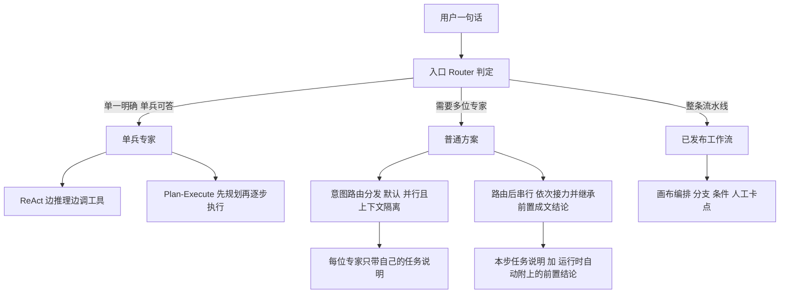

方案只保留两种协作模式，单选，默认意图路由分发：

| 页面名称 | 怎么跑 | 上下文 |
|----------|--------|--------|
| 意图路由分发 | 按候选简介选出一个或多个，并行执行 | 隔离，互不传结论，各自只带自己的任务说明 |
| 路由后串行 | 先按简介选出多个，再按执行顺序接力 | 必须继承前置结果，不能改成隔离 |

历史模板（固定并行、竞争选优、评审环、固定串行）不再作为可写选项：读取展示、保存、运行装载时统一收口到这两种。入口类型本身不会被收成「路由后串行」，它的执行语义始终是判定后分发。

**一问与多问**：入口先把一条消息里的多个问题拆开，再按问分别选目标；同一件事的多项交付仍算一问。拆问是规则式的（句末标点加「第二件事」引子），单问与闲聊行为不变。多问最多 5 路，超出部分并进最后一路，不丢问题；两问命中同一目标时并成一次执行。入口配置里的协作路数上限只约束「一个问题最多分给几个目标」，不截问题条数；多问也不做跨问汇总，各路只在自己的块里出结论。

**为什么方案只做分发**：一旦允许方案内部表达依赖与条件，它就会长成第二个工作流，两套编排语义会互相打架。边界划清楚——方案回答「谁来做」，工作流回答「按什么顺序、什么条件做」。三步以上、带条件判断的复杂依赖，引导到工作流。

### 5.4 串行交接

接力的输入是**本步的任务说明**，加上运行时自动附上的**前面已完成专家的成文结论**：

- 只取成文结论（助手终答正文），不带工具原始结果、不带思考过程、不带密钥。
- 单步与累计都有字符上限，超出尾部截断，避免一步步把上下文撑爆。
- 前一步失败不阻断后一步，只附一句短失败说明，让后一步知道这步没成。
- 不靠「让专家自己去读文件」完成交接；文件是产物，不是协议。

### 5.5 嵌套与防循环

- 方案可以把自己的候选设成另一套方案或一个已发布工作流，形成分层分发。
- 只有「进入下一套方案」才加一层深度，专家不算一层；深度上限为 3，超过即熔断并给出人话说明。
- 保存时拦自挂与互挂：自己挂自己、两套方案互相能走回彼此，直接拒绝；更长的环也给出可读的环路径。
- 只沿方案候选找环，专家与工作流不算回边，因此「入口 → 方案 → 专家」不会被误判成环。

### 5.6 会话生命周期与收口

- 会话在运行期间保持运行中；成功、失败、取消、删除各有终态。
- 进程重启后残留的「运行中」会被收成已取消，同时把该会话未收尾的追踪一并收口；正在本进程内跑的那一轮跳过。
- 空闲、取消、删除三处触发长期记忆抽取；会话再次发言会清掉抽取标记，允许下一轮空闲再抽。
- 发消息支持幂等键：同会话、同键、同内容只真正跑一轮，重复请求返回等价结果；同键不同内容返回冲突。

### 5.7 长任务与失败面

- 流式输出走统一帧协议，正文按批次合批，避免逐字刷库。
- 客户端断开可取消，服务端把本轮收成取消终态，不留悬挂。
- 工具调用有超时、重试上限与总次数上限；超时按失败终态处理，不无限挂起。
- 失败文案只给用户面话术，抹掉主机、端口、路径、异常类名与堆栈。

### 5.8 对话内停等与续跑

停等不是新开一轮，也不是在对话里另造一条审批时间线；它把「运行要等一句话」放回原执行现场。

- **工作流**：AGENT 节点可配「等待回复」。节点产出的问句与可点选项流进对话执行卡，运行迁到「等待回复」，调度停止。用户点选项或直接在输入框发送，都写回同一条运行的输入快照，从该节点接着走；选择记在原节点 / 原卡上，不另插一条用户气泡。直播、刷新、回放共用同一个卡片投影，不另起时间线。
- **方案**：串行接力（路由后串行与固定串行）可在成员询问处停等，等待快照落库；回复写进该成员的卡后继续剩余成员，不新建运行，也不再过一遍入口。
- **时限**：工作流图可配整段与单节点上限（分钟），受平台硬顶约束；执行卡展示上限与剩余。进入等待时以等待时刻为基准，等待时长不计入整段或单节点时限。
- **人工待办**：HUMAN 节点仍走独立待办页「看 + 通过 / 驳回」，与对话内停等是两条入口，不是互相替代。企业级审批策略、升级与留痕尚未补齐，见 §9.4。

边界：方案停等只在根层与一层嵌套（且该层只派了一位）开放，更深层没有完整恢复坐标；工作流只从等待中的运行续跑，运行已被并发收口时这一句按普通一轮继续，不吞用户消息。重复投递同一句时等待行已收口，第二次自然按普通一轮处理，不重放。

---

## 6. 能力域与职责边界

### 6.1 模型接入

三段式：**供应商 → 凭证 → 实例**。凭证加密存库、可解密出站，列表只出掩码；同一套协议适配层把不同厂家的请求、响应与流式事件收成一套内部模型，前端与运行时只认这一套。

按**用途**建实例与绑定：对话、路由、改写、摘要、记忆、嵌入、重排、视觉、语音识别、语音合成、护栏。用途不是标签，是行为边界——摘要模型不兼作记忆抽取，语音模型不拿对话模型冒充，协议确实没有该用途端点时明确报「不支持」，不拿对话接口凑。

嵌入与重排另有**平台级实例**：记忆的语义召回与检索后重排用它，不按 Agent 绑定解析。嵌入实例连通测试成功时写入维度快照，这就是向量集合的建集维度。

### 6.2 提示词分层

| 层 | 内容 | 谁能改 |
|----|------|--------|
| L1 | 平台全局约束：语言、工具边界、不得越权、不得编造 | 平台维护，按语言与版本发布生效 |
| L2 | 按用途的模板：对话、路由、改写、摘要、记忆抽取等 | 平台维护，段落分「锁定 Core」与「开放 Soft」 |
| L3 | 单兵或方案的覆写 | 只能改 Soft 段与追加区 |

组装只有一条链路：一次组装、一次性变量替换、按预算尾部截断，锁定段永不裁剪；缺 L1、缺模板、缺必选段一律阻断出站，不拼半截提示词。缓存三级（进程内 → Redis → 库）加单飞，发布后失效。

### 6.3 工具

两层目录「工具源 → 工具项」，内置与 MCP 同页管理。MCP 支持 SSE 与 Streamable HTTP 两种传输，按远端列表同步工具项，新同步项默认停用、人工启用。

进 schema 只有一条判据：**源启用 ∧ 项启用 ∧ Agent 已绑定**，装配与执行共用这一判据，不出现「schema 里有、调用时跳过」。内置知识库检索工具另有一道可用库闸门（见 6.5）：没有可用绑定库时整条不交给模型。

工具必填参数有闸门：本轮输入、会话上下文、已注入的长期记忆三档都无依据时，不执行工具，改为向用户追问，避免模型脑补参数。工具能力以绑定白名单硬拦，提示词不能扩权。

### 6.4 技能

可复用的 Markdown 正文，与模型、工具分离。常规按目录注入（标题 + 场景，预算内附全文）；命中触发词时不经模型判断直接强制注入正文。技能只影响「怎么写」，不改变「能用什么工具」。

### 6.5 知识库

建库即建集合，向量维度跟嵌入模型锁定。文档入库是一条流水线：格式白名单 → 解析 → 结构识别 → 按文档类型路由切片策略 → 向量化 → 双写向量库与切片表，状态与进度落库，可重试、可换片长重切。

检索：按原问选库 → 可选查询改写 → 向量召回 + 可选关键词召回 → 融合 → 截断 → 回表补全正文 → 可选重排。查询改写只在「该库开了改写开关」且「Agent 的改写用途槽有可用模型」时出站，任一门不满足或改写失败都回退原问句；改写成功后，开了该开关的库用改写句召回与重排，未开的库仍用原问，选库始终用原问，一次工具调用最多改写一次。

以工具形式交给 Agent，**库范围只来自 Agent 绑定**，模型无法越权指定库。Agent 没有任何可用绑定库时，内置检索工具整条不交给模型；有可用库时，把各库名称与描述写进工具说明（空描述保留并标「尚无描述」），模型仍不能靠入参点名选库。

失败语义与空结果分开：未绑定、无命中、向量库不可用三种情况各有固定话术，不用空数组冒充「没查到」。

页面侧同口径收口：新建 / 编辑弹窗为三个页签（基础信息、入库与切片、检索与重排），高级参数按表单字段回填与重建，未展示的合法键原样带回；新建库默认打开查询改写与本库重排。知识库列表加载失败保留已有数据并给错误条 + 重试，无数据时用错误块而不是「还没有知识库」冒充失败；状态文案统一为「可检索」，「重建集合」统一叫「重建索引」。弹窗沿用模型管理页的连通结果：未测通的嵌入实例在下拉中置灰，并提示去测通。

### 6.6 记忆

三层：

| 层 | 载体 | 用途 |
|----|------|------|
| 短期 | Redis 热数据 + 库内持久化 | 当前会话内的高频信息 |
| 长期 | 库为真源，向量为可重建副本 | 跨会话的偏好与事实 |
| 工作 | 库内按 Agent 组织 | 运行期工作记忆，不与长期混写 |

长期记忆只在三处抽取：**显式「记住」**、**会话收口**（空闲、取消、删除）、**滚动摘要成功后**；每轮成功或失败都不抽。显式「记住」异步投递，不占本轮首字延迟。

入库前先做事实键归并：同义偏好收敛到规范键，同键只留一条并保留更高的重要性；用户纠错会作为正常输入覆盖旧值，助手单方面的纠错独白不入库。

语义召回是旁路：库是唯一真源，向量集合可重建；写入时标记待同步，提交后异步双写，失败记录状态与次数并有界补同步。没有平台级嵌入、集合未就绪、出站失败时，召回直接回落库内排序，不空手也不编造。换维只能走受控重建，代码不会静默删生产集合。

窗口按轮次、字符、空闲时间规划，触顶先滚动摘要再裁剪旧轮，不裸切。

### 6.7 观测与计量

- **追踪**：一次提问一条 trace，一步一条 span，父子成树，能看出判定、分发、子专家、工具与模型调用。按人可见范围裁剪，管理员看全部，其他人只看自己的。
- **计量**：每次模型调用一条流水，另有业务日汇总；汇总可重算、幂等覆盖同维。**计费真源是流水**，追踪上的 token 字段只用于展示。
- **脱敏**：密钥、Authorization、密文、密码不进日志、不进追踪、不进操作日志；失败文案只给用户面话术。

两者都是「同源不同表」：同一次运行写三处，各表职责不混；追踪写失败吞掉，不影响对话与计量。

### 6.8 评测

用例集 → 复用现网运行入口跑批 → 规则断言做硬门禁 → 可选软评分。软评分默认不翻转门禁结论；未启动评分服务时标记为跳过，不影响规则结论。评测凭据由后端从模型中心解密后经本机环回透传，不进日志、不进库、不进报告。

---

## 7. 数据、安全与权限

### 7.1 数据原则

- MySQL 是配置与业务数据的真源；Redis 只放可重建的热数据与窗口；Milvus 只放可重建的向量副本。
- 库兼容 MySQL 5.7+，不使用 8.0 专有语法；不用物理外键，引用关系由应用层校验。
- 新库按 `sql/agenthub.sql`（只建表，已含全部结构增量）→ `sql/data-init.sql` → `sql/data-init-agent.sql` 初始化；`agenthub.sql` 含 `DROP TABLE IF EXISTS`，只用于新库或整库重建，已有数据的库不要重跑；用户体系相关表不允许删除重建。
- 存量库升级：对照当前 `sql/agenthub.sql` 补齐缺的表与列。这份建表脚本不能在旧库重跑；对应的增量脚本以后单独出，未出之前不要拿它当升级脚本执行。
- 时间字段统一以库内现列为准；新表沿用「开始 / 结束 / 创建 / 更新」四个时间语义的既有命名，不再另起一套。

### 7.2 权限

- 单一鉴权栈：Sa-Token，请求头 `Authorization: Bearer`。
- 权限码统一 `{域}:{资源}:{动作}`，菜单种子、后端注解、前端按钮同码；新增能力先定码再落三处。
- 数据范围按角色范围 + 部门路径**前缀**过滤，不用字符串包含匹配。
- 权限按域校验：模型、工具、技能、知识库、方案、运行、追踪、计量各有各的码；不靠前端隐藏当安全边界。

### 7.3 密钥边界

| 对象 | 存法 | 出站 |
|------|------|------|
| 调用方应用密钥 | 只存哈希，明文仅一次 | 校验哈希，不需要解密 |
| 模型 / MCP 凭证 | 加密存库，列表只出掩码 | 需要时解密出站 |
| 主密钥 | 环境变量或本机配置，不进仓库 | 不落库、不打日志 |

日志、追踪、操作日志、事件正文都不得出现密钥、完整授权头、密文与密码。

---

## 8. 部署拓扑

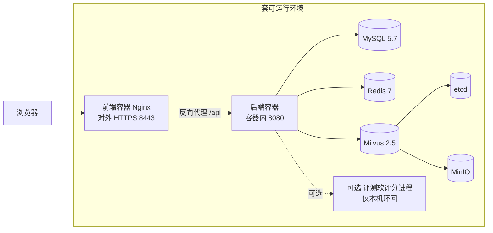

| 组成 | 说明 |
|------|------|
| 后端 | 单 jar，容器内 8080；宿主机直跑默认 8080，compose 映射到 8081 避免冲突；Compose 启动必需项由 `.env` 注入（库口令、主密钥、重置口令、数据源、Redis、Milvus URI、工作区路径），不强制挂载 `secrets/application-local.yml` |
| 前端 | 静态产物进 Nginx，反代 `/api/` 到后端；只对外映射 `8443→443`；缺证书时容器内自签并写入 `web_certs` 卷，重启复用，不进镜像 |
| MySQL | 库名 `agenthub`；compose 默认不暴露宿主端口；业务用户 `agenthub`，口令与 `.env` 的 `MYSQL_PASSWORD` 一致 |
| Redis | 记忆窗口、短期记忆、提示词缓存 |
| Milvus | 知识库与记忆向量；依赖 etcd 与 MinIO；未就绪时应用照常启动，只有建库、重建、检索报「不可用」 |
| 评测软评分 | 可选本机 Python 进程，未启动只是软评分跳过 |

**新库初始化**：按顺序执行三份正式脚本——`sql/agenthub.sql`（只建表，已吸收全部结构增量，含 `DROP TABLE IF EXISTS`，只用于新库或整库重建）→ `sql/data-init.sql`（sys 与平台基础，只跑一次）→ `sql/data-init-agent.sql`（运行必需的非 sys 配置，按业务键判存在，可重复执行）。`sql/data-init-test-tmp.sql` 只是可选的测试 / 演示配置（示例专家、Skill、工作流等），不是新库必跑，也不进仓。用 Compose 起**全新** `mysql_data` 卷时，MySQL 首次启动会按 `docker-entrypoint-initdb.d` 顺序自动执行上述三份；**已有数据卷不会自动执行任何脚本**。若旧卷缺第三份，在已运行的库上单独执行 `sql/data-init-agent.sql` 即可，不要删卷或 `docker compose down -v`。模型密钥、知识库文档与 `workflow_release` 仍不进任何 SQL，只能在界面配置或发布产生。正式仓库的初始化入口只有这三份脚本，不再以其他增量脚本作为新库初始化入口；已有数据的库不要重跑 `agenthub.sql`。存量库升级先对照这份建表脚本补缺的表与列，对应的增量脚本以后单独出。

一键入口：复制 `.env.example` 为 `.env` 并按该文件顶部注释填写 → `docker compose up -d --build`。控制台 `https://localhost:8443`（自签证书需信任一次）；账号 `admin`，口令口径见 `.env.example`。

后端不依赖 Milvus 启动，这是有意的：只做非检索功能的环境不需要起向量库。主实例端口以编排为准，排查问题时不要另起旁路实例。

---

## 9. 已落地 / 进行中 / 未做

口径日期：2026-11-24。

### 9.1 已落地

| 能力 | 现状 |
|------|------|
| 基座 | Sa-Token 单栈、菜单与按钮权限、部门路径数据范围、登录与操作日志、应用密钥哈希 |
| 模型中心 | 供应商 / 凭证 / 实例、按用途绑定、平台级嵌入与重排、连通测试矩阵、统一出站适配 |
| 工具 | 内置 + MCP 两层目录、同步与白名单、参数闸门 |
| 技能 | 正文管理、按目录注入、触发词强制注入 |
| 单兵 | ReAct 与 Plan-Execute、绑定装配、运行限制硬顶 |
| 对话入口 | 入口 Router 独立类型、唯一性由库保证、编码与备注锁定（名称可改）、路由池配置、未就绪引导 |
| 方案 | 只做分发、两种协作模式收口、路由池支持单兵 / 方案 / 工作流、去重、自挂与互挂拦截、深度上限 3；串行接力可在成员询问处停等并续跑同一轮 |
| 串行交接 | 只传成文结论、有字符上限、失败步给短说明 |
| 消息流 | 按参与者成块、多问在入口块列清去向、工作流单独执行卡、块出现后只补数据不重排、思考默认折叠、方案块不复制子专家正文、只有真汇总才出方案结论、文件挂到产出专家；检索出处贴结果旁，直播与回放共用同一投影 |
| 工作流 | 画布、草稿与不可变发布、运行、对话内停等续跑、整段 / 单节点运行时限、人工待办 |
| 提示词 | 三层、锁定段与开放段、统一组装与预算、三级缓存 |
| 知识库 | 建库建集合、入库流水线、查询改写接入运行时检索、双路召回与重排、检索工具按可用库交出、失败语义分离 |
| 配置页面 | 模型凭证重置与引用保护、Skill 定义与版本各自保存、提示词目录加载失败可重试、工具同步结果可追到新增工具项、批量启停前确认真实条数 |
| 记忆 | 三层、三处抽取、事实键归并、向量旁路与受控重建、窗口摘要 |
| 观测与计量 | 一次提问一条 trace、每次调用一条流水、业务日汇总、可见范围裁剪 |
| 评测 | 用例集、跑批、规则门禁、可选软评分 |
| 语音 | 整段听写与按回答朗读，只认该 Agent 的语音模型槽 |
| 工程侧 | 会话标题异步生成、发消息幂等、重启清残留运行中、统一线程池与有界队列、全链路脱敏；对话页按职责拆分；后台运行时 / 工作流外围第一波拆分（只搬外围，行为不变）；三份初始化脚本随仓交付（建表 / sys 基础 / 运行必需配置） |
| 交付 | 单 jar；仓内 Dockerfile 与 Compose 可拉起一套本机 / 单机环境（依赖 + 后端 + Nginx 前端） |

### 9.2 进行中

| 事项 | 当前状态 |
|------|----------|
| 后台大文件按波次拆分 | 第一波只拆运行时 / 工作流外围，行为与协议不变；直播、回放、停等主链路尚未动 |
| 入口详情的运行参数 | 页面目前把与总分流无关的运行项置灰，实际沿用已保存值；是否需要放开仍待确认 |
| 单兵列表与方案解耦 | 产品口径已断开，列表过滤仍借助历史列做子查询，属收尾中的技术债 |
| 入口判路由模型的用途收敛 | 方案未显式绑定模型时，平台槽仍可能回落到非路由用途的实例 |

### 9.3 未做（后续计划）

| 事项 | 说明 |
|------|------|
| 督导循环、运行中重规划 | 分发之后评估是否继续、是否重新规划，未做 |
| 工作流循环节点 | 画布尚无循环节点；循环次数、超限出路、迭代上下文与同节点多轮回放均未做 |
| 企业级方案闸门 | 「动态选人 + 静态闸门」尚未交代码；现网只有分发与深度上限 3 |
| 容器级沙箱 | 现网是运行目录隔离，不是容器隔离 |
| 按依赖自动改串行 | 协作模式由配置决定，不做自动改判 |
| 入站密钥调 Agent | 待应用授权补全 |
| 多层 / DAG 路由 | 只做分层分发，深度上限 3；不做方案任意图 |
| 非 token 计量 | 只做 token 计量；单价规则与计价展示当前关闭 |
| rerank 协议 | 精排当前只接 DashScope text-rerank，其它厂家的 rerank 协议未接 |
| Docker 生产部署交付 | 镜像发布与生产编排未做；现有 Dockerfile 与 Compose 只覆盖本机 / 单机一套环境 |
| 第三方数据集接入、评测坏案回流 | 未做 |
| 全链路追踪导出与多实例聚合 | 未做 |
| 企业 OAuth 与注册中心适配 | 只留接口缝 |
| 租户切换 | 一期单租户，租户由配置提供 |

### 9.4 接下来预期（规划，尚未开工）

以下是下一阶段的目标，按顺序排；当前 main **没有**这些实现，不能当成已落地或进行中。

1. **工作流循环节点**：循环必须显式声明，未声明的环保存即拒（现网已有有向环检测，但还没有声明式循环）；次数可配并有平台硬顶；超限必须有出路（下游、人工或失败），不许空转；迭代序号和打回反馈要进上下文；嵌套循环各自计数；直播 / 回放能看到同一节点多轮。无进展检测和墙钟不能代替最大次数。
2. **企业级方案一期**：只在「路由后串行」上做可选的静态闸门，含义是「动态选人 + 静态闸门」。不新建表、不画方案边、不做运行中重规划；崩溃续跑一期可降级。计划展示复用根层计划块。
3. **后台大文件按波次继续拆外围**：第一波已合；后续仍只拆运行时 / 工作流外围，不碰直播、回放、停等主链路。
4. **工作流入参出参**：路径模型可保留（如 `$.input.query`、`$.output.text`），补「点选插入 / 同名映射」，不改成另一套表达式语言。

更后（尚未排期）：配置数据按域归组（不是给表单加分组标题；多智能体列表分组先不做）；配置便于截图的场景 Agent；HUMAN 待办的超时策略完善（对话内停等已有，待办页策略尚未按企业级补齐）。

仍明确不做（即使目标在往企业级走）：督导循环、运行中自动重规划；容器级沙箱；按依赖自动把方案改成串行；把方案做成第二套工作流画布。

---

## 10. 风险与已知债

只列架构级风险，细节在《AgentHub-代码质量检查清单》里。

1. **结构与脚本同步**：新库按 `sql/agenthub.sql` 建表，该文件是现库结构的完整快照，已含全部结构增量。以后新增表 / 列 / 索引时，必须同步更新这份建表脚本；漏了会让新库缺列或缺口，应用启动后写配置、跑对话直接报错。已有数据的库不要重跑建表脚本：存量库升级先对照它补缺的表与列，对应的增量脚本以后单独出，当前阶段这部分仍需人工核对，是升级路径上尚未补齐的一环。初始化三份脚本已随仓，入口行与运行必需配置由 `sql/data-init-agent.sql` 幂等补齐，不再依赖本地归档脚本。模型密钥、知识库文档与 `workflow_release` 仍只能由界面产生，不随 SQL 交付。
2. **历史模板残留**：旧模板码在读取、保存、装载三处收口，但执行器里旧拓扑仍在。若有脏数据绕过保存校验，仍可能跑到已下线的拓扑。
3. **前端巨型组件（已减负，未解决）**：对话页已按职责拆出方案卡、工作流执行卡、工具条、选项、结果框与引用区，直播 / 回放框架未改；但 `ChatPanel` 仍是较长的壳层与投影文件，单兵详情也偏长。拆分只降低改动半径，不等于大文件问题已解决，消息流调整仍需回归直播、刷新、回放三条路径。后台运行时 / 工作流第一波也只是外围搬家，主链路未动。
4. **入口唯一性依赖单行数据**：结构上能拦第二行，但拦不住「把唯一那行改成不合法状态」的人工操作；编码与备注锁定、不可停用是主要防线。
5. **单租户假设**：租户由配置提供，多租户隔离是设计预留而非已实现能力，对外不要说成「支持多租户」。
