# AgentHub 架构设计

> 本文描述现网代码的架构事实，不含进度流水与操作步骤。能力边界以根目录 `README.md` 为准，冲突时以代码为准。

## 1. 定位与边界

### 1.1 是什么

AgentHub 是**可独立部署的 Java Agent 中台**：单模块 Spring Boot（JDK 17）+ Vue3 管理台，既能以单 jar 运行，也能以 Docker Compose 整栈部署。

它解决的问题是「企业内多个业务要接 Agent，但模型、工具、知识库、提示词、记忆各配一遍、各写一套调用」：平台把配置收拢成目录（模型 / 工具 / Skill / 知识库 / 提示词 / Agent），把运行收敛成一条链路（装配 → 编排 → 出站 → 观测），业务侧只面对 Agent。

配置驱动是主线：**不写代码也能改行为**——换模型、加工具、挂知识库、改提示词、调记忆策略都在控制台完成，运行时不重启。

### 1.2 三类身份与权限边界

| 身份 | 载体 | 现状 |
|---|---|---|
| 平台用户 | `sys_user` / `sys_role` / `sys_menu` / `sys_dept` | 已落地。Sa-Token 登录，`Authorization: Bearer <token>` |
| 调用方应用 | `sys_app` / `sys_app_agent` | 表与 `appId` + `apiKey`（只存哈希）已落地；**入站 apiKey 调 Agent 未接线** |
| 终端用户上下文 | `spi` 的 `AgentContextHolder` 等接口 | 接口与 ThreadLocal 实现已落地；企业侧适配未做 |

平台只做**薄 RBAC**：回答「谁能配置模型 / 工具 / Agent」「谁能试跑」「谁能看运营数据」「能看谁的数据」。权限码格式 `{域}:{资源}:{动作}`，四方一致（需求、菜单种子、后端注解、前端按钮）。数据范围（`data_scope` + 部门 `path` 前缀）目前只覆盖用户 / 部门 / 应用三个域，其余业务域按设计取舍不按部门裁剪。

`agenthub.security.mode` 只有 `local` 可用，`oauth2` / `passthrough` 仅保留枚举。

### 1.3 不做什么

- **不是**若依式多 module 单体：单模块 Maven，按域分包，禁止 `system` / `framework` 这类大包名。
- **不做** Spring Security 与 Sa-Token 双栈，鉴权只有 Sa-Token。
- **不手写** while-ReAct 主循环替代引擎：ReAct 推理循环、路由子 Agent 的执行都走 AgentScope-Java 的 `ReActAgent`，平台只做装配、路由分发与边界控制。
- **不自建**业务行级权限引擎、多租户隔离、workspace 切换。

### 1.4 明确未落地（不得当作能力描述）

| 项 | 现状 |
|---|---|
| **Reflection / 自我反思增强** | 代码中不存在。计划执行模式的「单步重试」是失败重试，不是反思阶段 |
| **Auto 模式 / 自动规划** | 无该枚举、无 UI。规划只由用户显式选择 `PLAN_AND_EXECUTE` 触发 |
| **检索链路中的查询改写执行** | `rewriteEnabled` 只是 `retrieval_config` 里的参数位，`REWRITE` 槽只承载「绑模型 + L3 提示词」，运行时**不执行改写** |
| **入站 apiKey 调 Agent** | `SaTokenConfigurer` 只认平台用户 Token，应用鉴权入口未接 |
| 其他 | MCP Server 化、A2A / DAG 画布、OTel、多实例实时增量（`TrialLiveBuffer` 为进程内）、Vault / KMS、企业 OAuth、Nacos 适配 |

---

## 2. 逻辑分层总图

前端只与 `/api/**` 通信；每个域内部是 `api → application → domain → infra` 四层：Controller 零业务、AppService 不碰 Mapper / Entity、Entity 不出 `infra`、跨域只读走对方 `domain` 的仓储接口或显式 Port（例如 `agent.domain.service.PlatformConstraintSource` 由 `prompt` 域实现，避免 `agent ↔ prompt` 循环依赖）。

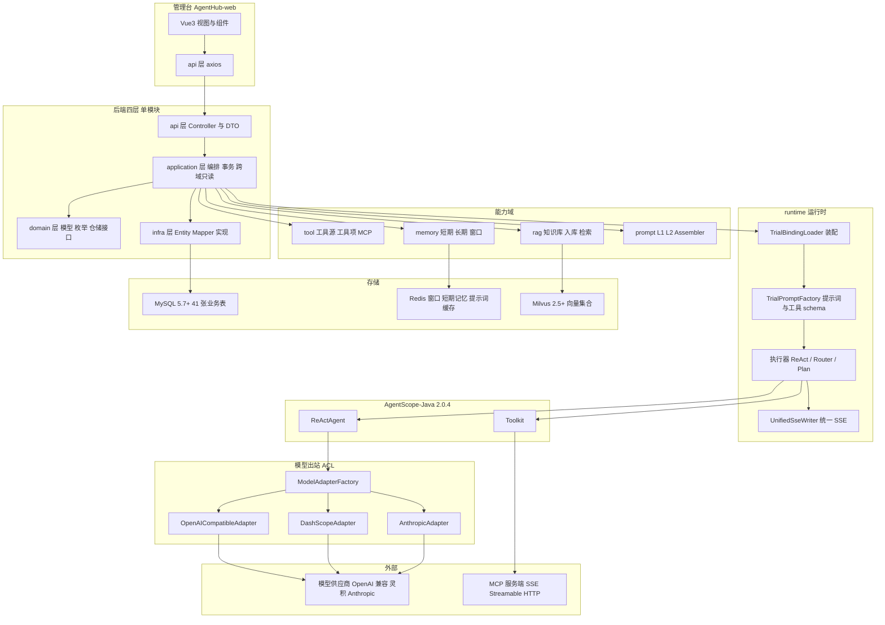

**分层之外的两条横切**：`common`（`Result` / 错误码 / 分页 / 用户面文案清洗）与 `audit`（登录日志、操作日志），任何域都可依赖，但它们不反向依赖业务域。

---

## 3. 一次试跑的主链路

控制台试跑是最完整的执行路径：装配、编排、出站、观测、计量在同一条链上一次走完。入口 `POST /api/runtime/trial/sessions/{id}/messages/stream`，身份是**已登录的平台用户**（不是 apiKey）。

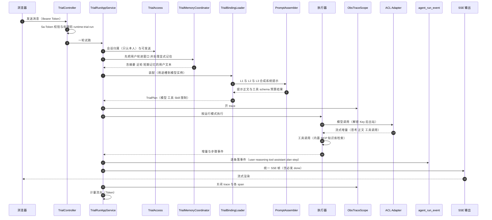

**链路上的四个约束**：

1. **鉴权在两处**：`Sa-Token` 拦接口，`TrialAccess` 再按 `user_id` 裁会话——管理员也看不了别人的试跑。
2. **模型调用在事务外**：一轮要跑数十秒，包进事务会长期占连接且外部调用不可回滚；事件在结果确定后落库，会话多轮期间保持 `RUNNING`。
3. **装配只读**：`TrialBindingLoader` 只读 `agent` / `model` / `tool` / `skill` 的领域仓储，不改配置、不复制密钥。
4. **失败不改写历史**：本轮失败只写 `error` 事件与 `error_summary`，接口 `data.status` 表示这一轮成败，不回滚已落事件。

**SSE 契约**：统一事件类型 `message.delta` / `thinking.delta` / `tool_call.delta` / `tool_call.completed` / `usage` / `error` / `done`，同时保留旧事件名（`assistant` / `reasoning` / `tool` / `done` / `error`）以兼容前端分发逻辑。**`done` 必发**：正常结束、降级结束、超时、取消都要发一次，前端不得因收到 `error` 就自行结束 Loading。

---

## 4. 三种运行模式

运行模式是 Agent 的配置属性（`AgentRunMode`），不是运行时自动选择。

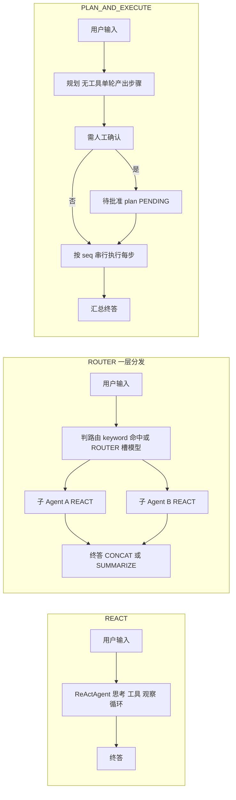

| 模式 | 关键约束 |
|---|---|
| `REACT` | 单 Agent 直接绑定模型 / 工具 / Skill / 记忆 / 知识库；也可作为 Router 子节点（子节点必须是启用中的 REACT） |
| `ROUTER` | 只做分发：父节点不绑工具 / 技能 / 记忆 / 知识库，UI 隐藏这些 Tab。判路由输出**有序** `[{route_key, sub_query}]`；≥2 子并行，多意图**强制隔离上下文**（子只看 `sub_query`），单意图可继承父历史。终答默认拼接，可配父模型汇总，汇总失败降级拼接并给出可见说明 |
| `PLAN_AND_EXECUTE` | 三段：规划（无工具单轮）→ 按 `seq` **串行**执行（每步一次独立 `ReActAgent`）→ 汇总。不做步骤间并行，不作为 Router 子节点，不新增 PLAN 用途槽（复用 CHAT） |

**待批准计划的存放**：`PlanPendingRegistry` 是进程内登记表（有超时、只能消费一次），因为它要复用规划时那份「已拼好摘要 / 近轮 / 短期记忆」的用户侧文本——重新拼会把窗口滚动摘要推进两遍。服务重启后登记项消失，批准接口明确返回「没有待批准的计划」，**不静默降级执行**。

**限制体系**：轮次、墙钟、工具与 LLM 调用次数、重试次数、连续失败阈值、工具结果字符数都由 `agenthub.runtime.limits.*` 给 `default` + `max`，Agent 可覆盖但必须 ≤ max，生效值 `min(覆盖或 default, max)`。撞限写 `error_summary` 与 `finish_reason`。

---

## 5. 模型防腐

### 5.1 三段式数据

`model_provider`（厂商 + 协议 + baseUrl）→ `model_credential`（加密 Key + 掩码）→ `model_instance`（Model ID + 用途 + 温度 + 维度）。`agent_model_bind` 只引用实例，不复刻 Key。

唯一性按业务语义收紧：供应商名称全局唯一；凭证同供应商内唯一；**实例按「同供应商 + 同 Model ID + 同用途」唯一**（同一 Model ID 可按不同用途并存）；实例展示名**同供应商内唯一**（不同供应商允许同名，如两家都叫 qwen-tts）。有实例不许删供应商，被引用的凭证不许删——这类关系由 `ModelReferencePolicy` 在应用层拒绝，库上不建物理外键。

### 5.2 用途是配置的主轴

用途（`ModelCapability`）五组十一码：生成 `CHAT` / `ROUTER` / `REWRITE` / `SUMMARY` / `MEMORY`，检索 `EMBEDDING` / `RERANK`，多模态 `VISION`，音频 `ASR` / `TTS`，安全 `GUARDRAIL`。

生成类五码出站形态都是 chat，但**业务语义互不借用**：摘要不得当记忆抽取用，记忆不得借摘要模型。温度按用途取默认：对话 / 多模态 `0.7`，路由 / 改写 / 摘要 / 记忆 `0.2`，嵌入 / 重排 / 音频 / 护栏锁 `0` 且出站不带 `temperature` 字段。

**用途决定配置入口，不只是标签**：`RERANK` 的唯一入口在 Agent 详情的「知识库」Tab（检索链路，单槽）；`SUMMARY` / `MEMORY` 在「记忆配置」Tab；`EMBEDDING` 不提供 Agent 绑定，跟知识库选型走。避免同一能力出现两个配置入口。

**协议 × 用途矩阵**（连通测与出站共用 `ModelPurposeMatrix`；`✓` 已适配，`—` 该协议无对应端点，明确返回「该协议不支持此用途」）：

| 用途 | `OPENAI_COMPAT` | `DASHSCOPE` | `ANTHROPIC` |
|---|---|---|---|
| CHAT / ROUTER / REWRITE / SUMMARY / MEMORY | ✓ `chat/completions` | ✓ 兼容 `chat/completions` / 原生 `text-generation` | ✓ `messages` |
| EMBEDDING | ✓ `/embeddings` | ✓ 兼容 `/embeddings` / 原生 `text-embedding` | — |
| RERANK | — 无官方 `/rerank` | ✓ 原生 `text-rerank` | — |
| VISION | ✓ 多模态 `chat/completions` | ✓ 兼容 `chat/completions` / 原生 `multimodal-generation` | ✓ `messages` + image source |
| ASR | ✓ `/audio/transcriptions` | ✓ 兼容 `/audio/transcriptions` / 原生 `qwen3-asr-flash` 同步 | — |
| TTS | ✓ `/audio/speech` | ✓ 兼容 `/audio/speech` / 原生 `SpeechSynthesizer` | — |
| GUARDRAIL | ✓ `/moderations` | ✓ 聊天协议探活 | ✓ Messages 分类提示探活 |

GUARDRAIL 只验证「审核口可达」；本期对话链路尚无运行时拦截点，探活成功不代表已上线内容审查。

**TTS 附加参数**（`model_instance.extra_json.speechParams`）：用户在实例编辑里按厂家文档填一段 JSON 对象（≤8KB），平台只做「JSON 对象 / 体积 / 控制字符 / 凭证与保留键」校验，**不做键名映射**；出站按协议浅合并到 TTS 报文的可选参数位置：

| 形态 | 合并位置 | 说明 |
|---|---|---|
| 兼容口 `OPENAI_COMPAT` / DashScope `compatible-mode` | 请求体顶层 | `POST /audio/speech`，与 `model` / `input` / `voice` / `response_format` 同级 |
| DashScope 原生 | `input` 内 | `POST /services/audio/tts/SpeechSynthesizer`，与 `text` / `voice` / `format` / `sample_rate` 同级 |

`model` / `input` / `file` / `text` 与凭证类键（`api_key` / `Authorization` …）一律由平台持有，用户 JSON 不得覆盖；空配置时行为与改造前一致。`extra_json` 列需为 `text`（见 `sql/temp/schema-delta-model-extra-json.sql`），`varchar(2000)` 装不下 8KB 参数。

### 5.3 解析链

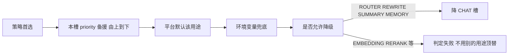

解析结果带来源（`POLICY` / `SLOT` / `PLATFORM` / `ENV` / `DEGRADED_CHAT`）与降级优先级，供观测记录。实例被选中后还要再过一层「真的可用」判定：实例启用 ∧ 供应商启用 ∧ 凭证启用且密文非空，否则视同不可用并尝试槽内下一个。

### 5.4 协议适配与出站

防腐层在 `runtime.model.acl`：对外只有 `Unified*` 类型（请求 / 响应 / 消息 / 工具定义 / 工具调用 / 用量 / 流式事件 / 结束原因），**厂商字段名只允许出现在 `acl.impl` 包内**，且不引入任何厂商 SDK，HTTP 出站只用 WebClient + Reactor。

| 协议 | 适配范围 |
|---|---|
| `OPENAI_COMPAT` | 多数中转、vLLM、本地网关，也承接灵积的 compatible-mode |
| `DASHSCOPE` | 原生 generation 接口；baseUrl 含 compatible-mode 时内部委派给 OpenAI 兼容实现 |
| `ANTHROPIC` | Messages 协议，含 thinking block 与 `tool_use` 的增量参数 |
| `CUSTOM` | 本期不做，工厂明确报错而不是静默降级 |

新增协议的代价被约束成一个接口：实现 `VendorStreamDecoder` 即可，SSE 切帧、`done` 兜底、上游错误脱敏都已共用；**不允许**在 Adapter 里另写一套收尾逻辑，否则「五条收尾路径」（正常 / 降级 / 超时 / 取消 / 异常）的一致性会被打破。

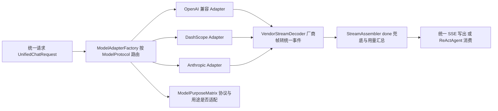

「协议 × 用途」矩阵是连通测试与出站的分流依据：未适配的组合（如拿对话接口测重排、拿 OpenAI 兼容测 DashScope 专有的 text-rerank）必须明确报错，不能拿 Chat 冒充。

---

## 6. 提示词三层

### 6.1 三层职责

| 层 | 作用域 | 维护者 | 载体 | 可改性 |
|---|---|---|---|---|
| **L1 平台约束** | 全局，每次模型调用前置 | 超级管理员 | `prompt_global_constraint`（按 locale 版本化） | Agent 不可见、不可改 |
| **L2 用途模板** | 按用途（不是按模型型号） | 平台 / 算法管理员 | `prompt_template` + `prompt_template_segment` | 段落分「锁定 Core」与「开放 Soft」 |
| **L3 Agent 覆写** | 单 Agent 单用途 | Agent 配置者 | CHAT → `agent_def` 四列；非 CHAT → 对应用途槽的 `agent_model_bind` 四列 | 只能覆盖 Soft 段 + 追加区 |

L2 的主键维度是用途，与生成类五码一一对应；同 `用途 + 语言` 只允许一个生效版本，同用途也只允许一个模板键——服务端会拒绝第二个键，绕过前端直接打接口也造不出来。

L3 的关键设计是**钉版本**：选模板时同时写入模板 id 与版本号，平台发新版只在下拉旁提示「有可升级版本」，必须显式点「升级」才换版本。旧覆盖里有新版不存在的段时标「待清理」并拦住保存与预览，避免静默丢配置。

### 6.2 组装顺序

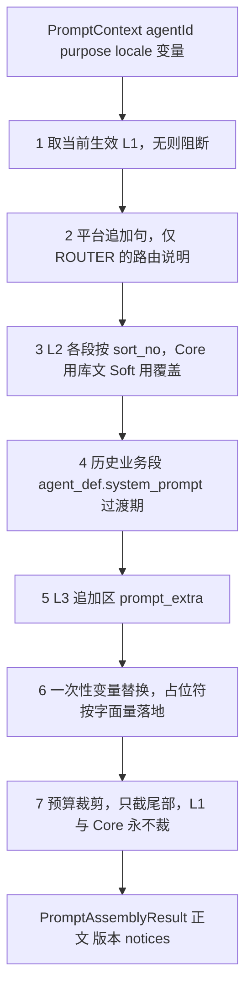

CHAT 与非 CHAT 只在**入口适配器**不同（`PromptContextAdapters.fromChat` / `fromModelBind`），组装只有一条链路；禁止写两套拼接。

### 6.3 阻断与缓存

「缺配置」与「业务空结果」必须区分：

| 情形 | 行为 |
|---|---|
| 无生效 L1 | 抛 `PROMPT_UNAVAILABLE`（HTTP 409），不拼半截、不退回 classpath 文案 |
| 用途无生效 L2 | 抛「用途未配置模板」，禁止拿别的用途顶替 |
| 模板用途与请求不符 / 钉死版本漂移 | 抛异常，不静默升级 |
| 必选段缺失或空白 | 抛「缺必选段」 |
| 未注册变量 / 已注册未赋值 | 抛异常，绝不把占位符原文送模型 |
| 覆盖键在该版不是 Soft 段 | 只告警不失败（模板升级后旧键失效不该炸线上） |

缓存三级：Caffeine（进程内，短 TTL）→ Redis（多实例共享）→ DB（只读已发布行）。键由统一工具类拼，钉死版与当前生效版分键。并发未命中走单飞（同键只打一次 DB），确认不存在做 10 秒负缓存防打穿。**失效在事务提交后**（`afterCommit`）执行——事务内清缓存会出现「提交前旧值被并发读者写回」的永久脏读。

另有一道出站闸门 `AssembledPromptGuard`：创建 ReActAgent 前校验系统提示确实以平台约束开头，否则拒绝出站，防止某条路径只喂了用户业务段。

---

## 7. 知识库（RAG）

### 7.1 建库与可见性

一库一集合（`LOCAL_MILVUS` 唯一实装），集合字段由平台定死、管理员不配。维度跟嵌入模型锁定：优先读实例的维度声明，缺失时用创建请求兜底，两者都没有直接拒绝；建库后维度锁定，换模型只能新建库。

能力落库而非假设：先试 dense + sparse，Milvus 不支持稀疏向量时自动降级为纯向量，并把真实能力写进 `store_capability`（`DENSE_BM25` / `DENSE_ONLY`），避免界面显示「支持混合检索」而实际只做了向量。

**可见性只有一个判据** `RagAccessPolicy`：列表过滤、绑定校验、运行时检索三处都调它。各写一套的结果是「列表看不到、运行时却查得到」的泄漏。

建库顺序：先落 MySQL 拿 id（状态 `INIT_FAILED`）→ 建集合 → 回写 `READY` / `INIT_FAILED`。Milvus 调用**不进数据库事务**（远程调用不可回滚，且会长期占连接）；建集失败不抛异常，返回可读 `errorMsg`，列表里可点「重建集合」恢复。删库顺序相反：先删集合成功再逻辑删记录，避免「记录没了集合还在」。

### 7.2 入库流水

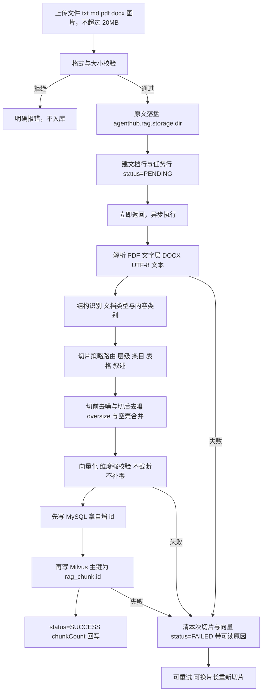

三个关键取舍：

1. **异步不占请求线程**：上传只做校验 + 落盘 + 建任务行，解析 / 切片 / 向量化 / 写入在线程池执行。任务状态**落库**而非存内存，进程重启后仍能看到失败原因并重试。
2. **先 MySQL 后 Milvus**：向量库主键就是切片表自增 id，拿不到 id 无法双写对齐。任一步失败都清掉本次半成品，不留「MySQL 有行、Milvus 没有」的孤儿。
3. **不加事务**：整条流水含解析、模型调用、向量库写入等长耗时外部调用，包进事务会长期占用连接且外部写不可回滚；一致性靠「失败补偿 + 任务状态机」保证。

同名文档视为重灌：复用文档行、代次 +1、先清旧切片与旧向量。删除顺序是删向量 → 删切片 → 删任务 → 逻辑删文档 → 删原文件，反了会留下无法定位的孤儿向量。

### 7.3 检索流水

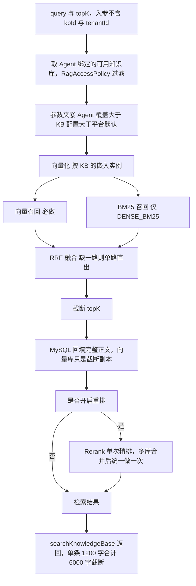

参数优先级 **Tool 入参 topK > Agent 绑定覆盖 > KB 的 retrieval_config > 平台默认**，全部在解析器里夹紧到硬上限（`topK` 默认 5、上限 20；召回默认 20、上限 100），避免 Agent 配置把召回放大到打爆上下文。多库场景下 Agent 级重排延后到合并后统一做一次——各库先排会让分数不可比，出站次数也与库数成正比。

**故障 ≠ 空结果**，工具侧三种固定话术：

| 状态 | 语义 |
|---|---|
| `NO_BINDING` | 未绑定知识库，能力未开通 |
| `NO_HIT` | 明确告知没有依据、不要编造 |
| `KB_UNAVAILABLE` | 知识库暂时不可用，稍后再试 |

向量召回为空但 MySQL 仍有切片，说明集合未同步，按故障处理；多库全部失败向上抛，禁止冒充「没查到」。知识库范围**只来自 Agent 绑定**，工具入参里没有库标识，模型无法越权指定。

---

## 8. 工具与 MCP

工具统一进「工具源 → 工具项」两层目录，三种来源同一套装配口径：

| 途径 | 类型 | 注册方式 |
|---|---|---|
| 内置 Java 工具 | `BUILTIN`（只读源） | 按 `@Tool(name)` 扫 Spring 单例，`toolkit.registerTool` |
| MCP 远端工具 | `MCP` | 按远端 `tools/list` 建可调用句柄，调用时发 `tools/call` |
| 知识库检索 | 登记在 `BUILTIN` 源下 | 与内置工具同一注册通道（它本身也带 `@Tool`） |

差别只在来源与实现归属，**装配口径完全一致**：同一套 tools-schema 预算、同一绑定顺序、同一启停判据。

### 8.1 进 schema 的唯一判据

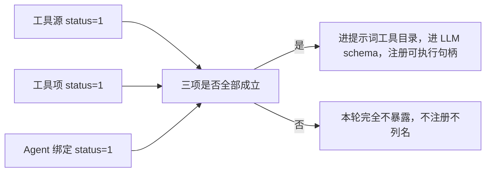

装配侧与执行侧**共用**这一个判据（`ToolEnablement`）。禁止「schema 全量、执行时再跳过」——那样模型会伪造文本形式的工具调用并中止本轮。

预算也是硬约束：系统段、Skill 段、工具 schema 段三段独立预算、专款专用不互挪；可调用工具必须「完整 schema 塞进预算且可注册」才进目录，禁止只留名字却当作可调用。超预算未暴露的工具会在目录页脚写明，与 Skill 段截断分开报。

### 8.2 必填参数闸门

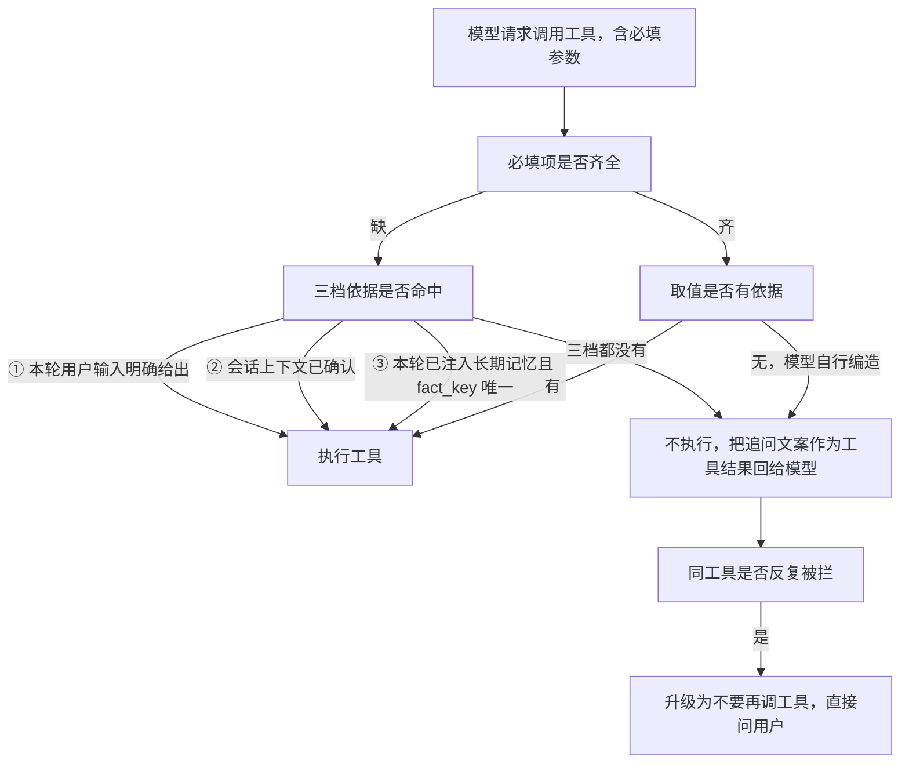

被拦下的调用**不出站、不占工具配额、不计连续失败**——否则一个模型偏好就会被判定成工具故障。ReAct、Router 子 Agent、计划执行的单步都走同一规则。

### 8.3 MCP 同步语义

按远端 `tools/list` 以 `name` 对齐本源工具项，**不是纯增量**：

- 远端有本地无 → 插入，`status=0`（同步后默认停用，人工启用是白名单动作）。
- 两端都有 → 更新说明与 schema，`status` 保持本地原值；展示名本地非空则保留。
- 远端无本地有 → 逻辑删除下架，移出可绑清单。
- 同源同名历史重复行一并下架，只留最早一条。

同步是「以远端为准收敛」而不是「只加不减」，否则远端删掉的工具会永远留在可绑清单里。远端失败只更新 `last_sync_*`，不动已有工具项；同步消息与日志不写鉴权头、密文、主密钥。

MCP 鉴权头与模型 Key 共用同一套加密（AAD 分别绑定供应商 id 与工具源 id），所以密文搬到别的源解不开。

---

## 9. 记忆分层与窗口控制

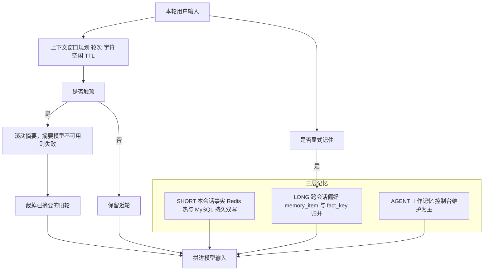

| 层 | 触发与载体 |
|---|---|
| `SHORT` | 键按 `agentId + sessionId`。先写 Redis 再写 MySQL，MySQL 失败回滚 Redis；Redis 不可用时本次写入失败而不是静默丢弃。控制台列表读 MySQL，未命中用未过期的库行回填 |
| `LONG` | 只在**显式「记住」**、**会话结束**（空闲超时 / 懒结案 / 取消 / 删除进行中会话）、**滚动摘要成功后**三处抽取，**每轮成功或失败都不抽**。同 `fact_key` 合并去重，正文拦密钥样式 |
| `AGENT` | 跟 Agent 走的工作记忆，控制台维护，运行时不自动沉淀 |

**抽取消隐与闸门**（四件套齐全才允许批抽）：批抽总闸（默认关闭）、会话级幂等标记、正文最短长度下限、单次收口会话数上限。摘要与抽取使用**不同用途模型**，`MEMORY` 不降 `SUMMARY`，两者各有环境变量兜底。

**注入位置**：工作记忆与用户偏好由 `PromptInjectionComposer` 统一安放在系统提示的**业务段收口之后、Skill 与工具目录之前**，与其他段落预算分开计算；它属于追加区，超预算时最先让出。只注入「本轮真正进来的」长期记忆，并把这份清单交给工具必填参数闸门作为第三档依据。清空会话只丢 Redis 热窗口并清批抽标记，不抽长期记忆。

> 顺序依据：`docs/提示词工程.md` 第六节。记忆必须排在工具目录**之前**——否则模型先读完工具清单才看到偏好，「该不该调工具 / 调哪个」的判断带不上偏好。

上下文窗口的规划规则：轮数或字符任一超限即触顶，触顶先滚动摘要再裁旧轮；只有一轮且自身超长时，超长部分进旧段、尾部保留能放进预算的后缀。摘要模型不可用就失败，**不静默改用主聊天模型**，也不只裁不摘要。

---

## 10. 可观测

### 10.1 Trace 与 Span

一次用户提问一条 trace，每一步一条 span。`seq` 在同一条 trace 内从 1 串行递增（原子自增，避免模型回调与工具回调抢号）；`step_no` 是展示号（串行整数，仅并行分叉带点号）。树键是自增 id + `parent_id`，**不拍扁**。

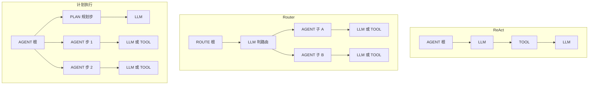

Plan 的 `PLAN` 步与各执行步**互不为父子，都是串行兄弟**；Router 的子 Agent 并行时每线程独立 span 栈，子节点显式带父 id 发起，不靠共享 ThreadLocal。延迟用**墙钟毫秒**计算，避免秒级时间精度把父子步挤成同一秒。

`TASK` 类型预留给后续编排，一期对话埋点禁止写入。

### 10.2 脱敏是链路级约束

| 组件 | 作用范围 |
|---|---|
| `UserFacingText` | 面向用户的失败文案：抹掉盘符与路径、脚本名、IP、localhost、内网域名、裸端口、异常类名、状态码、中间件名；堆栈行整行丢弃；上限 120 字；只剩遮罩时退回固定话术 |
| `ModelCallErrors` | 只按异常**类型**映射固定中文（超时 / 连接失败 / 鉴权失败 / 限流 / 模型不存在 / 请求被拒 / 服务不可用），不拼异常原文 |
| `TrialTexts` | 写库侧：预览、摘要、正文按列上限脱敏 + 截断；JSON 里 `api_key` / `secret` / `token` / `password` / `authorization` / `cipher` / `key` 等键的值一律打成掩码 |
| `LlmSpanTexts` | 观测侧只记「平台前缀：已应用」+ 本轮增量，不落整段系统提示 |

原则：**故障不等于业务空结果**。工具失败只给用户话术，原始 cause 只进服务端日志。操作日志只记配置动作摘要（谁改了哪个模型的哪个字段），不记对话全文、提示词正文、工具实参。

### 10.3 旁路写入

同一轮试跑会同时写三处互不混用的表：会话事件（`agent_run_session` / `agent_run_event`，给用户回看）、观测（`obs_trace` / `obs_span`，给排障与性能）、计量（`billing_token_ledger` / `billing_token_daily`，给用量统计）。埋点或计量失败**不影响试跑本身**；模型客户端还没建成时也补记一条 0 token 的失败流水，避免这一步在链路上凭空消失。

---

## 11. 部署拓扑

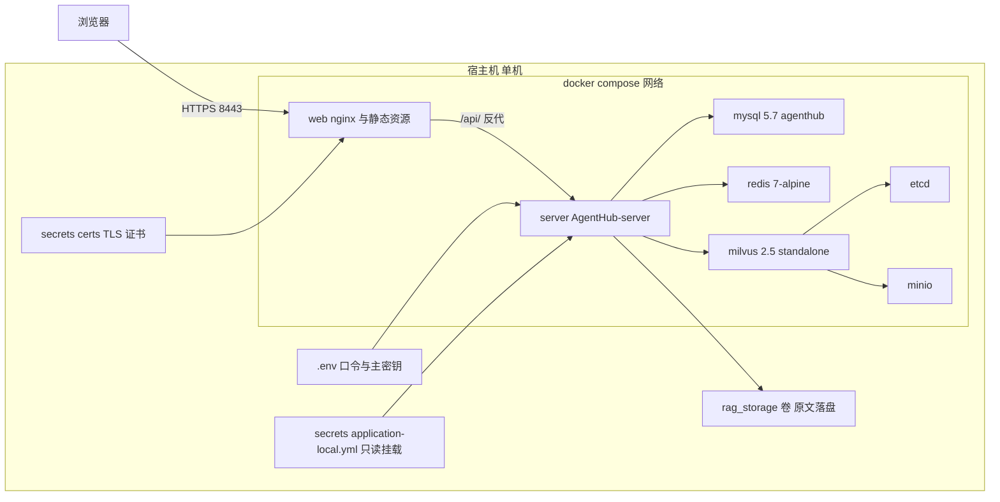

| 服务 | 宿主端口 | 说明 |
|---|---|---|
| `server` | `8081` → 容器 `8080` | 后端。容器内按服务名连库与 Milvus，外部配置与 RAG 原文以卷挂载 |
| `web` | `8088` → 容器 `80`、`8443` → 容器 `443` | Nginx 托管静态资源并反代 `/api/`；容器内 80 只做 HTTPS 跳转 |
| `mysql` | 默认不暴露（需要时 `3307:3306`） | 首次创建数据卷时自动执行全量建表与种子脚本 |
| `redis` | `6380` → `6379` | 上下文窗口、短期记忆、提示词缓存；Sa-Token 仍是单机会话，不存 Redis |
| `milvus` | `19530`（gRPC）、`9091`（healthz / metrics） | 依赖 etcd 与 minio 健康后才启动；首次启动有预热期 |
| `etcd` / `minio` | 不暴露（minio 控制台需要时开 `9000` / `9001`） | 仅 Milvus 内部使用 |

**依赖方向是单向的**：`server` 在 compose 里**不**依赖 `milvus`——向量库未就绪时后端照常启动，只有建库 / 重建集合 / 检索返回「知识库不可用」。这让「不跑 RAG 的部署」不必拖一个向量库进来。

**持久化卷**：`mysql_data`、`etcd_data`、`minio_data`、`milvus_data`、`rag_storage`。删 `milvus_data` 等于清空所有知识库向量；`rag_storage` 与向量库分开，因为原文要能回溯切片。

**密钥边界**：主密钥与库口令只从环境变量或仓库外的 `application-local.yml` 注入（该文件已被构建排除，并有构建期断言）；TLS 证书与私钥放宿主机只读挂载。`.env`、`secrets/`、`*.pem`、`*.key` 全部不进仓库。

**多实例注意**：试跑实时增量的镜像（`TrialLiveBuffer`）与待批准计划登记表都是进程内状态，跨实例需另行走 Redis；Sa-Token 也仍是单机会话。

---

## 12. 能力现状总表

| 状态 | 域 | 内容 |
|---|---|---|
| 已落地 | 基座 | Sa-Token 登录与权限点、用户 / 角色 / 菜单 / 部门 / 应用 CRUD、部门前缀数据范围、登录与操作日志 |
| 已落地 | 模型 | 供应商 / 凭证（加密 + 掩码 + 轮换）/ 实例（用途 + 温度 + 唯一性）/ 连通测试矩阵 |
| 已落地 | 协议 | 统一 ACL + 三协议 Adapter + 统一 SSE 七类事件 + `done` 兜底 + 取消 |
| 已落地 | Agent | 三模式定义、模型槽、工具 / 技能 / 子路由绑定、运行配置 |
| 已落地 | 提示词 | L1/L2 管理端单页、L3 表单驱动覆写、Assembler + 三级缓存 + 出站阻断 |
| 已落地 | 工具 | 源 / 项两层目录、内置工具、MCP 双传输与同步、RAG 检索工具、批量启停、预算装配、必填参数闸门 |
| 已落地 | RAG | 建库与集合初始化、文档入库与切片、切片查看与重切、混合检索 + 可选重排、Agent 多库绑定 |
| 已落地 | 运行时 | 试跑会话生命周期、SSE 流式与续订、Router 多意图并行、计划执行含批准态、多智能体 `ma_def`（虚拟根 / 六模板 / `COMPETE` / `VOTE`）、预算与限制 |
| 已落地 | 评测 | 规则断言硬门禁（`gate_passed`）+ OpenJudge 软评分（`scores.openjudge.*`，本机 sidecar）；软分默认不翻转 gate |
| 已落地 | 记忆 / 观测 / 计量 | 三层记忆与窗口控制、Trace / Span 树与按人可见、Token 流水与日汇总 |
| 部分可用 | 改写 | 配置位与开关存在，**运行时未执行改写** |
| 部分可用 | 数据范围 | 只覆盖用户 / 部门 / 应用，其余域不按部门裁剪 |
| 部分可用 | 多实例 | 实时增量与待批准计划为进程内状态 |
| 部分可用 | 重排 | 只适配 DashScope text-rerank，其他协议明确不支持 |
| 未落地 | 见 1.4 | Reflection、Auto 模式、入站 apiKey、MCP Server 化、A2A / DAG、时间轴视图、Vault / KMS / OTel / 沙箱 |
